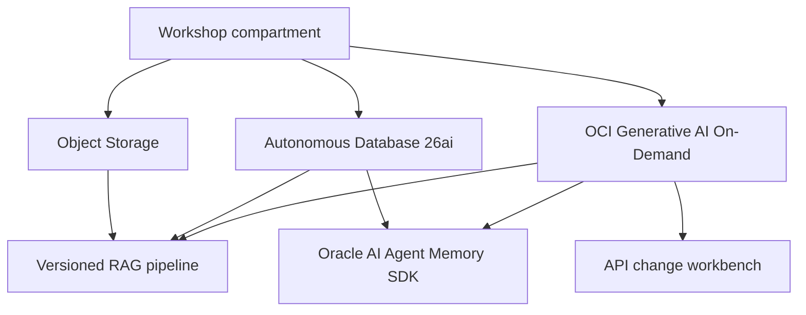

# Architecture

## Purpose

Deliver three hands-on OCI AI labs that can be validated in a personal Trial tenancy and later reproduced in the Khipu tenancy without changing application code.

## Target topology

## Isolation model

The workshop uses a shared platform with a team namespace. Every request and resource artifact must carry `team_id`.

| Component | Isolation mechanism |
|---|---|
| Lab 1 deployment gateway | A verified team identity; the server derives the scope and rejects a claimed `team_id` that does not match it |
| Agent Memory | Server-derived `user_id`, `agent_id`, `thread_id`, and metadata filters |
| Autonomous Database | One database user/schema per team |
| Object Storage | One prefix per team |
| Source repository | One local clone or branch per team |
| Evidence | One output directory per team |

The repository contains a loopback-only FastAPI rehearsal gateway that proves this boundary without OCI credentials. It is not an OCI deployment and does not persist to ADB. The Khipu platform must replace its local HMAC rehearsal identity with the tenancy-approved identity integration before remote publication is enabled.

## Environment strategy

| Environment | Purpose | Network default | Lifecycle |
|---|---|---|---|
| Trial Chicago | Validate scripts, model IDs, quotas, timings, and troubleshooting | Public managed endpoints with secure credentials | Disposable |
| Khipu | Deliver the participant workshop | Pending Khipu security decision | Customer governed |

## Terraform boundary

Terraform creates the OCI foundation: compartment, tags, optional IAM policies, bucket, and optional Autonomous Database. It does not contain database passwords or create database schemas. Post-provisioning bootstrap scripts create logical team namespaces only after a secure connection has been established.

## Cost controls

- Use only on-demand inference; do not create dedicated AI clusters.
- Set explicit prompt and output limits in lab code.
- Use synthetic documents and a small, fixed corpus.
- Keep the Autonomous Database disabled by default in Terraform until an approved plan is reviewed.
- Record model IDs, input size, latency, and token measurements as evidence.
