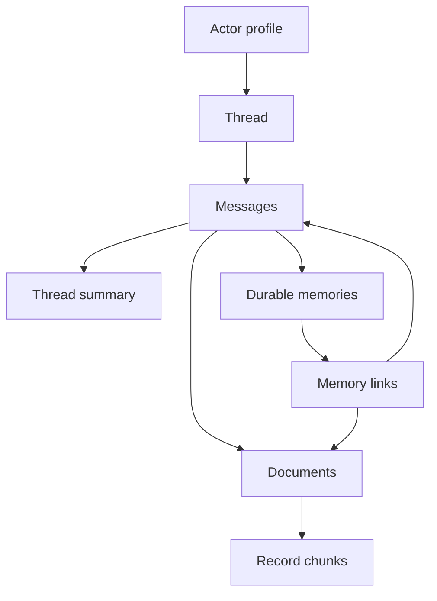

# Workshop 1 — Despliegue limpio en un tenant OCI nuevo

Esta guía es privada para facilitación. Describe únicamente pasos confirmados durante la preparación de un tenant nuevo. No se distribuye a participantes ni se publica junto con sus materiales.

## Propósito

Preparar de forma repetible un tenant trial para Workshop 1: una Autonomous AI Database 26ai, Oracle AI Agent Memory, acceso mínimo a OCI Generative AI y ejecuciones aisladas por participante.

## Principios operativos

- Región objetivo: `us-chicago-1`.
- El laboratorio usa `cohere.command-a-03-2025` como modelo on-demand aprobado para la comparación real.
- No registrar en esta guía OCIDs, contraseñas, wallets, tokens, contenidos de archivos de sesión ni resultados que los revelen.
- Usar un perfil OCI local separado por tenant; nunca reutilizar el archivo de sesión de otro tenant.
- Crear recursos de costo o IAM únicamente después de revisar un `terraform plan` y obtener aprobación explícita.

## Hito 1 — Crear el compartment del workshop

En OCI Console:

1. Abrir **Identity & Security → Compartments**.
2. Seleccionar **Create compartment**.
3. Completar:

```text
Name: cmp-khipu-ai-memory-dev
Description: Isolated resources for Khipu AI Memory Workshop 1
Parent Compartment: Root
```

4. Confirmar que el estado sea **Active**.

Resultado confirmado: el compartment se creó correctamente. Terraform reutilizará este compartment; no debe crear uno adicional.

## Hito 2 — Crear una sesión OCI local separada

En una nueva ventana de PowerShell:

```powershell
Set-Location "C:\Users\Lesbia Galindez\Documents\Codex_projects\KHIPU WORKSHOP"

New-Item -ItemType Directory -Force "C:\KhipuPrivate\oci" | Out-Null

$khipuMemoryConfig = "C:\KhipuPrivate\oci\khipuaimemory-config"

oci session authenticate `
  --config-location $khipuMemoryConfig `
  --profile-name KHIPU_MEMORY_OWNER `
  --region us-chicago-1
```

Completar el inicio de sesión de OCI en Chrome con el tenant nuevo y volver a PowerShell.

## Hito 3 — Reparar el perfil de sesión cuando falta `user`

Algunas sesiones creadas con `oci session authenticate` pueden conservar `tenancy`, `region` y `security_token_file`, pero omitir la clave `user`. El síntoma es una configuración inválida que indica `user missing` o una validación que no responde.

Comprobar solo la presencia de claves, sin mostrar valores:

```powershell
$configContent = Get-Content -Raw -LiteralPath $khipuMemoryConfig

@("user=", "tenancy=", "region=", "security_token_file=") | ForEach-Object {
  "$_ $($configContent.Contains($_))"
}
```

Si `user= False` y las demás claves son `True`, ejecutar el reparador local:

```powershell
powershell -ExecutionPolicy Bypass -File ".\labs\lab01_agent_memory\scripts\repair_oci_session_profile.ps1" `
  -ConfigFile $khipuMemoryConfig `
  -ProfileName KHIPU_MEMORY_OWNER
```

Salida esperada:

```text
OCI_SESSION_PROFILE_USER_READY True
The private session profile was repaired locally without printing token or user values.
```

El reparador toma el identificador de usuario desde el token de sesión local y actualiza únicamente el perfil privado. No imprime el token ni el identificador.

## Hito 4 — Validar la sesión y conectividad OCI

La validación remota del OCI CLI requiere conexión HTTPS directa hacia `identity.us-chicago-1.oci.oraclecloud.com` por el puerto 443. Una VPN corporativa puede bloquear esa ruta aunque la autenticación en Chrome haya finalizado correctamente.

Con la VPN desconectada, validar la sesión:

```powershell
oci session validate --config-file $khipuMemoryConfig --profile KHIPU_MEMORY_OWNER --auth security_token
```

Salida esperada:

```text
Session is valid until ...
```

Si la validación tarda más de 30 segundos, cancelar con `Ctrl + C`, confirmar primero la conexión TCP y volver a intentar sin reintentos:

```powershell
Test-NetConnection identity.us-chicago-1.oci.oraclecloud.com -Port 443

oci session validate --config-file $khipuMemoryConfig --profile KHIPU_MEMORY_OWNER --auth security_token --connection-timeout 10 --read-timeout 20 --no-retry
```

Resultado confirmado: con la VPN desconectada, la sesión OCI del tenant nuevo fue validada exitosamente.

## Hito 5 — Validar el plan Terraform en el compartment existente

Este despliegue reutiliza el compartment aprobado del workshop. No debe crear un bucket, una política IAM, una red ni un segundo compartment.

La autenticación Terraform con un token de sesión requiere que el perfil OCI nombrado esté disponible en el archivo privado estándar de OCI. El siguiente ayudante sincroniza solo el perfil nombrado y crea un respaldo local antes de modificar la configuración estándar:

```powershell
Set-Location "C:\Users\Lesbia Galindez\Documents\Codex_projects\KHIPU WORKSHOP"

powershell -ExecutionPolicy Bypass -File ".\labs\lab01_agent_memory\scripts\sync_oci_session_profile.ps1" `
  -SourceConfigFile $khipuMemoryConfig `
  -ProfileName KHIPU_MEMORY_OWNER

Set-Location ".\terraform\environments\trial-chicago"
terraform init
terraform validate
```

El archivo local `terraform.tfvars` debe mantener estas protecciones:

```hcl
create_workshop_compartment = false
existing_compartment_id     = "<approved-workshop-compartment-ocid>"
existing_compartment_name   = "cmp-khipu-ai-memory-dev"
enable_object_storage       = false
enable_iam_policies         = false
enable_autonomous_database  = true
autonomous_compute_count    = 2
```

El namespace de Object Storage es un dato de entrada del módulo reutilizable, pero no crea un bucket mientras `enable_object_storage = false`.

No guardar la contraseña administradora de ADB en archivos. En la ventana actual de PowerShell, ingresarla mediante el prompt oculto y exportarla solo para Terraform:

```powershell
$adbPassword = Read-Host -AsSecureString
$env:TF_VAR_autonomous_admin_password = [System.Net.NetworkCredential]::new("", $adbPassword).Password
```

Ejecutar el plan:

```powershell
terraform plan -var-file="terraform.tfvars"
```

Resultado validado esperado:

- `Plan: 2 to add, 0 to change, 0 to destroy`.
- Una adición es Autonomous Database.
- La segunda es `terraform_data.validate_compartment_input`, una precondición interna de Terraform que valida las entradas del compartment existente. No crea un recurso OCI.
- La salida `reviewable_participant_policy_statements` es texto para revisión; no representa una política IAM porque `enable_iam_policies = false`.
- `workshop_compartment_id` se refiere al compartment existente aprobado; no crea otro compartment.

No ejecutar `terraform apply` hasta revisar que el plan contiene únicamente estas dos adiciones y que los ajustes de ADB son correctos. El state de Terraform puede contener metadatos sensibles de despliegue: conservarlo localmente y nunca confirmarlo en Git.

## Próximo hito

## Hito 6 — Crear Autonomous Database

Después de revisar el plan y obtener aprobación explícita para el consumo del tenant trial, ejecutar:

```powershell
terraform apply -var-file="terraform.tfvars"
```

Cuando Terraform solicite confirmación, escribir `yes`.

Resultado confirmado en el tenant nuevo:

```text
Apply complete! Resources: 2 added, 0 changed, 0 destroyed.
```

Los dos elementos corresponden a:

1. La Autonomous Database del workshop.
2. La validación interna `terraform_data.validate_compartment_input`.

No se creó un bucket, una política IAM ni un compartment adicional. Los identificadores que Terraform muestra como outputs son confidenciales de operación: no pegarlos en documentación, mensajería ni repositorios. El archivo `terraform.tfstate` queda local y nunca se confirma en Git.

## Próximo hito

## Hito 7 — Descargar y validar un wallet privado de instancia

En la página de detalles de la ADB:

1. Seleccionar **Database connection**.
2. Elegir **Instance wallet**, no **Regional wallet**.
3. Seleccionar **Download wallet**.
4. Definir una contraseña de wallet nueva y distinta a la contraseña administradora de la ADB.
5. Descargar el ZIP solo en el equipo local. Nunca compartirlo ni incorporarlo a Git.

Extraerlo en una carpeta privada. Ajustar la ruta del ZIP según la descarga local:

```powershell
$walletZip = "C:\Users\Lesbia Galindez\Downloads\Wallet_KHIPUWS.zip"
$walletDir = "C:\KhipuPrivate\wallet_khipuaimemory"

if (Test-Path -LiteralPath $walletDir) {
  throw "The private wallet directory already exists. Stop and confirm its contents before replacing it."
}

New-Item -ItemType Directory -Force $walletDir | Out-Null
Expand-Archive -LiteralPath $walletZip -DestinationPath $walletDir -ErrorAction Stop

@("tnsnames.ora", "sqlnet.ora", "cwallet.sso", "ewallet.p12") | ForEach-Object {
  "$_ : $(Test-Path -LiteralPath (Join-Path $walletDir $_))"
}
```

Resultado confirmado: `tnsnames.ora`, `sqlnet.ora`, `cwallet.sso` y `ewallet.p12` existen en la ruta privada.

No eliminar el ZIP descargado hasta lograr la primera conexión exitosa. Una vez validada, mantener tanto el ZIP como la carpeta extraída fuera del repositorio y de cualquier carpeta sincronizada o compartida.

## Próximo hito

## Hito 8 — Preparar el wallet y SQLcl para la primera conexión

Configurar la ruta privada del wallet y seleccionar el único servicio TP sin imprimir el alias:

```powershell
$env:LAB01_WALLET_DIR = "C:\KhipuPrivate\wallet_khipuaimemory"
$env:TNS_ADMIN = $env:LAB01_WALLET_DIR

$tpAliases = @(
  Select-String -LiteralPath "$env:LAB01_WALLET_DIR\tnsnames.ora" -Pattern '^\s*([A-Za-z0-9_]+)\s*=' |
    ForEach-Object { $_.Matches[0].Groups[1].Value } |
    Where-Object { $_ -match '_tp$' }
)

if ($tpAliases.Count -ne 1) {
  throw "Expected exactly one TP service alias in the wallet."
}

$env:LAB01_DB_DSN = $tpAliases[0]
Write-Host "LAB01_WALLET_READY $([bool](Test-Path -LiteralPath $env:LAB01_WALLET_DIR))"
Write-Host "LAB01_DB_DSN_READY $(-not [string]::IsNullOrWhiteSpace($env:LAB01_DB_DSN))"
```

Para que SQLcl esté disponible en cada nueva ventana de PowerShell:

```powershell
$env:Path = "C:\Tools\sqlcl\bin;$env:Path"
sql -V
```

Usar `sql -V`, no `sql --version`.

Resultado confirmado: SQLcl 26.3 está disponible localmente.

## Próximo hito

## Hito 9 — Validar la primera conexión administrativa

Con `LAB01_WALLET_DIR`, `TNS_ADMIN` y `LAB01_DB_DSN` definidos en la misma ventana de PowerShell, conectar con SQLcl:

```powershell
sql "ADMIN@$env:LAB01_DB_DSN"
```

Cuando SQLcl solicite `Password?`, ingresar la contraseña administradora definida para la ADB durante `terraform apply`. No ingresar la contraseña del wallet.

En `SQL>`, verificar la versión sin imprimir alias ni identificadores:

```sql
SELECT banner_full FROM v$version FETCH FIRST 1 ROW ONLY;
exit
```

Resultado confirmado: la conexión administrativa por mTLS funciona y la base informa Oracle AI Database 26ai.

## Próximo hito

## Hito 10 — Crear el memory owner del equipo T01

Conectar como `ADMIN` mediante SQLcl y ejecutar el script mediante ruta absoluta, porque SQLcl puede no resolver rutas relativas cuando se abre desde otra carpeta:

```powershell
sql "ADMIN@$env:LAB01_DB_DSN"
```

En `SQL>`:

```sql
@"C:\Users\Lesbia Galindez\Documents\Codex_projects\KHIPU WORKSHOP\platform\bootstrap\02_create_agent_memory_owner.sql" T01
```

El script solicita localmente una contraseña nueva para el memory owner. No usar comillas simples, comillas dobles ni `&`; no almacenar ni compartir esa contraseña.

Resultado confirmado: el script informó `MEMORY_OWNER_CREATED` y `MEMORY_OWNER_READY` para el owner del equipo T01.

## Próximo hito

## Hito 11 — Bootstrap real de Oracle AI Agent Memory

Salir de SQLcl si continúa abierto y, desde la raíz del proyecto, definir solo los identificadores no secretos del owner:

```powershell
Set-Location "C:\Users\Lesbia Galindez\Documents\Codex_projects\KHIPU WORKSHOP"

$env:LAB01_MEMORY_SCHEMA_OWNER = "OAM_T01_OWNER"
$env:LAB01_MEMORY_OWNER_DB_USER = "OAM_T01_OWNER"
$env:LAB01_MEMORY_STORE_ID = "OAMT01"
```

Ejecutar el bootstrap una sola vez:

```powershell
.\.venv\Scripts\python.exe .\labs\lab01_agent_memory\scripts\bootstrap_team_memory.py --team-code T01
```

En los prompts locales, escribir `BOOTSTRAP`, luego la contraseña del memory owner y finalmente la contraseña del wallet.

Resultado confirmado:

```text
PLSQL_PACKAGE_READY 1
CONTROL_MEMORY created
LAB01_TEAM_MEMORY_READY
```

Este paso instaló el paquete oficial de Agent Memory en el esquema owner, creó el memory store lógico `OAMT01` y sembró una decisión sintética de control para probar aislamiento. No hizo llamadas a OCI Generative AI.

## Próximo hito

## Hito 12 — Crear el usuario temporal de aplicación P01

Conectar como `ADMIN` y ejecutar el script con ruta absoluta:

```powershell
sql "ADMIN@$env:LAB01_DB_DSN"
```

En `SQL>`:

```sql
@"C:\Users\Lesbia Galindez\Documents\Codex_projects\KHIPU WORKSHOP\platform\bootstrap\03_create_agent_memory_application_user.sql" T01 P01
```

El script solicita localmente una contraseña de aplicación. No usar comillas simples, comillas dobles ni `&`; no almacenar ni compartir la contraseña.

Resultado confirmado:

```text
APPLICATION_USER_CREATED OAM_T01_P01
APPLICATION_USER_READY OAM_T01_P01
```

En este punto el usuario puede iniciar sesión, pero todavía no tiene acceso a la memoria del owner.

## Próximo hito

## Hito 13 — Otorgar acceso runtime mínimo al usuario P01

Conectar como el memory owner:

```powershell
sql "OAM_T01_OWNER@$env:LAB01_DB_DSN"
```

En `SQL>`, ejecutar:

```sql
@"C:\Users\Lesbia Galindez\Documents\Codex_projects\KHIPU WORKSHOP\platform\bootstrap\04_grant_agent_memory_runtime_access.sql" OAM_T01_P01 OAMT01
```

Resultado confirmado:

```text
AGENT_MEMORY_RUNTIME_ACCESS_READY OAM_T01_P01 TABLES=8
```

`TABLES=8` no significa que este script haya creado ocho tablas. El bootstrap previo del SDK ya creó sus tablas administradas; el script recorrió las tablas existentes cuyo nombre empieza por el prefijo del store (`OAMT01_`) y otorgó solo `SELECT`, `INSERT`, `UPDATE` y `DELETE` a P01. También concede el `EXECUTE` runtime y lecturas mínimas requeridas por el SDK, sin privilegios `CREATE`, `ALTER`, `DROP` ni administración del store.

El número de tablas puede cambiar en futuras versiones del SDK. Para inspeccionar los nombres reales como owner, sin mostrar contenido ni datos, ejecutar:

```sql
SELECT table_name
FROM user_tables
WHERE SUBSTR(table_name, 1, LENGTH('OAMT01_')) = 'OAMT01_'
ORDER BY table_name;
```

## Próximo hito

## Hito 14 — Explicar la estructura interna del memory store

La consulta ejecutada como owner mostró ocho tablas administradas por el SDK. Todas comienzan con `OAMT01_`, el prefijo del memory store lógico. No se deben modificar directamente: el SDK mantiene su consistencia, relaciones y contratos de versión.

| Tabla | Propósito práctico |
| --- | --- |
| `OAMT01_ACTOR_PROFILE` | Perfiles persistentes de actores, como usuarios o agentes. |
| `OAMT01_DOCUMENT` | Documentos o artefactos textuales asociados a interacciones y memorias. |
| `OAMT01_MEMORY` | Memorias durables: guidelines, hechos, preferencias y decisiones recuperables. Esta es la tabla central del Lab 1. |
| `OAMT01_MEMORY_LINK` | Relaciones entre una memoria y los mensajes o documentos que la respaldan; aporta trazabilidad. |
| `OAMT01_MESSAGE` | Turnos conversacionales, con contenido, rol, secuencia y scopes. |
| `OAMT01_RECORD_CHUNKS` | Fragmentos de registros para recuperación granular. |
| `OAMT01_THREAD` | Conversaciones, tareas o sesiones que agrupan mensajes y estado. |
| `OAMT01_THREAD_SUMMARY` | Resúmenes compactos de threads para sostener contexto de corto plazo. |



La distinción didáctica del workshop es:

- Memoria de corto plazo: `THREAD`, `MESSAGE` y `THREAD_SUMMARY`.
- Memoria de largo plazo: `MEMORY`, perfiles y relaciones.

El Lab 1 persiste una guideline procedural de idempotencia en el scope individual del participante, la recupera por palabra clave y la envía como contexto mínimo al modelo. La reducción real de tokens no proviene de una compresión ficticia, sino de recuperar desde ADB solo la decisión necesaria en lugar de reenviar todo el contexto.

Referencias oficiales:

- [Oracle AI Agent Memory overview](https://docs.oracle.com/en/database/oracle/agent-memory/26.8/guide/about.html)
- [Oracle AI Agent Memory record types](https://docs.oracle.com/en/database/oracle/agent-memory/26.8/guide/api/records.html)
- [Oracle AI Agent Memory stores and schema](https://docs.oracle.com/en/database/oracle/agent-memory/26.8/guide/api/stores.html)

## Próximo hito

## Hito 15 — Revocar privilegios temporales de bootstrap

Tras confirmar que el bootstrap del store y el acceso runtime de P01 fueron exitosos, conectar como `ADMIN` y ejecutar:

```powershell
sql "ADMIN@$env:LAB01_DB_DSN"
```

En `SQL>`:

```sql
@"C:\Users\Lesbia Galindez\Documents\Codex_projects\KHIPU WORKSHOP\platform\bootstrap\05_revoke_agent_memory_setup_privileges.sql" OAM_T01_OWNER
```

Resultado confirmado:

```text
AGENT_MEMORY_SETUP_PRIVILEGES_REVOKED OAM_T01_OWNER
```

Este paso conserva el store, las ocho tablas y sus datos. Solo revoca `CREATE PROPERTY GRAPH` y `CREATE TRIGGER`, permisos temporales que se usaron durante el bootstrap y que ya no necesita el owner en runtime.

## Próximo hito

## Hito 16 — Generar y validar la sesión privada de P01

El archivo de sesión privada mantiene fuera del repositorio las rutas locales y los identificadores necesarios para el runner. No contiene contraseñas, tokens ni contenido del wallet.

Para recuperar el identificador del compartment desde el state local de Terraform en PowerShell, interpolar explícitamente el argumento `-chdir`; de lo contrario Terraform recibe el texto literal de la variable:

```powershell
Set-Location "C:\Users\Lesbia Galindez\Documents\Codex_projects\KHIPU WORKSHOP"

$participantSession = "C:\KhipuPrivate\sessions\T01-P01-session.ps1"
$terraformDirectory = (Resolve-Path ".\terraform\environments\trial-chicago").Path
$compartmentId = terraform "-chdir=$terraformDirectory" output -raw workshop_compartment_id
```

El archivo privado se creó a partir de `labs\lab01_agent_memory\config\participant-session.ps1.example`, con los valores locales de P01 y sin imprimirse su contenido. Validar solo presencia de configuración:

```powershell
. $participantSession

Write-Host "LAB01_PARTICIPANT_SESSION_READY $(Test-Path -LiteralPath $participantSession)"
Write-Host "LAB01_PARTICIPANT_COMPARTMENT_READY $(-not [string]::IsNullOrWhiteSpace($env:OCI_COMPARTMENT_ID))"
```

Resultado confirmado:

```text
LAB01_PARTICIPANT_SESSION_READY True
LAB01_PARTICIPANT_COMPARTMENT_READY True
```

## Próximo hito

## Hito 17 — Ejecutar el preflight de P01 sin inferencia

Ejecutar desde la raíz del proyecto:

```powershell
powershell -ExecutionPolicy Bypass -File ".\labs\lab01_agent_memory\scripts\run_participant_live.ps1" `
  -TeamCode T01 `
  -ParticipantCode P01 `
  -SessionFile "C:\KhipuPrivate\sessions\T01-P01-session.ps1" `
  -Preflight
```

Cuando se soliciten valores locales, ingresar la contraseña del usuario de aplicación `OAM_T01_P01` y la contraseña del wallet.

Resultado confirmado:

```text
LAB01_PREFLIGHT_DATABASE_ACCESS True
LAB01_PREFLIGHT_MEMORY_STORE_ACCESS True
LAB01_PREFLIGHT_INFERENCE_CLIENT_READY True
LAB01_PREFLIGHT_COMPLETE
```

El preflight no hizo solicitudes a OCI Generative AI ni consumió inferencias. Confirma conectividad ADB, acceso al store con la política `REQUIRE_EXISTING` y la construcción local del cliente de inferencia.

## Próximo hito

## Hito 18 — Ejecutar memoria real de P01 sin inferencia

Ejecutar:

```powershell
powershell -ExecutionPolicy Bypass -File ".\labs\lab01_agent_memory\scripts\run_participant_live.ps1" `
  -TeamCode T01 `
  -ParticipantCode P01 `
  -SessionFile "C:\KhipuPrivate\sessions\T01-P01-session.ps1" `
  -MemoryExercise payment-idempotency
```

Resultado confirmado:

```text
SELECTED_PROCEDURE payment-idempotency
RETRIEVED_PROCEDURES payment-idempotency
PERSISTENCE_CONFIRMED True
ISOLATION_PASS True
NO_OCI_INFERENCE True
```

La evidencia se guarda localmente en `artifacts\lab01\t01\p01\memory-exercise-payment-idempotency-evidence.json`. Contiene solo datos sintéticos y no incluye contraseñas, token OCI ni wallet.

Interpretación: P01 persistió una guideline procedural en Autonomous Database, recuperó únicamente la decisión relevante mediante búsqueda `KEYWORD` y no pudo recuperar el registro del scope de control. Esta prueba demuestra aislamiento de recuperación por scope dentro del SDK; no equivale por sí sola a una política de seguridad de filas de base de datos.

## Próximo hito

## Hito 19 — Renovar una sesión OCI vencida antes de inferencia

Una ejecución de inferencia puede fallar con `401 INVALID_AUTHENTICATION_INFO` cuando el token de sesión OCI vence. Ese error ocurre antes de que el modelo procese la solicitud; no produce evidencia aceptable ni telemetría de tokens.

Renovar la sesión privada:

```powershell
Set-Location "C:\Users\Lesbia Galindez\Documents\Codex_projects\KHIPU WORKSHOP"

$khipuMemoryConfig = "C:\KhipuPrivate\oci\khipuaimemory-config"

oci session authenticate `
  --config-location $khipuMemoryConfig `
  --profile-name KHIPU_MEMORY_OWNER `
  --region us-chicago-1 `
  --session-expiration-in-minutes 60
```

Después de completar el inicio de sesión en el navegador, reparar el perfil local si OCI CLI omitió la clave `user` y validar remotamente:

```powershell
powershell -ExecutionPolicy Bypass -File ".\labs\lab01_agent_memory\scripts\repair_oci_session_profile.ps1" `
  -ConfigFile $khipuMemoryConfig `
  -ProfileName KHIPU_MEMORY_OWNER

oci session validate `
  --config-file $khipuMemoryConfig `
  --profile KHIPU_MEMORY_OWNER `
  --auth security_token `
  --connection-timeout 10 `
  --read-timeout 20 `
  --no-retry
```

Resultado confirmado: la sesión OCI fue renovada y devolvió `Session is valid until ...`.

El archivo de sesión de P01 conserva la misma ruta de configuración, por lo que no debe regenerarse después de la renovación.

## Próximo hito

## Hito 20 — Completar la comparación real de tokens de P01

Con una sesión OCI válida, ejecutar la corrida live una sola vez:

```powershell
powershell -ExecutionPolicy Bypass -File ".\labs\lab01_agent_memory\scripts\run_participant_live.ps1" `
  -TeamCode T01 `
  -ParticipantCode P01 `
  -SessionFile "C:\KhipuPrivate\sessions\T01-P01-session.ps1"
```

El runner persiste y recupera las decisiones sintéticas, comprueba aislamiento y hace exactamente dos solicitudes OCI Generative AI on-demand: baseline y memoria. La evidencia se acepta solo cuando OCI devuelve métricas completas y ambas respuestas pasan el criterio de calidad.

Resultado confirmado en el tenant nuevo:

```text
PERSISTENCE_CONFIRMED True
ISOLATION_PASS True
BASELINE_PROMPT_TOKENS 113
MEMORY_PROMPT_TOKENS 86
INPUT_TOKEN_REDUCTION 27
TOKEN_QUALITY_PASS True
```

`INDIVIDUAL_CREATED 0` e `INDIVIDUAL_EXISTING 2` son esperados en una segunda corrida: indican que el runner detectó las dos memorias sintéticas previamente creadas para P01 y evitó duplicarlas.

La evidencia final está guardada localmente bajo `artifacts\lab01\t01\p01\oci-inference-evidence.json`. El JSON incluye, para ambas variantes, tokens de entrada, salida y totales, latencia, estado de finalización y resultado de validación. Nunca contiene contraseñas, tokens OCI ni archivos de wallet.

Interpretación validada: la variante con memoria recupera desde ADB la regla procedural pertinente y envía menos contexto al mismo modelo y con los mismos parámetros. Esto prueba eficiencia de contexto medida por OCI; no afirma por sí solo un menor costo total de la solución, que también incluye almacenamiento, recuperación y operación de memoria.

## Próximo hito

## Hito 21 — Visualizar la evidencia final en el dashboard

Iniciar el dashboard local desde una nueva ventana de PowerShell:

```powershell
Set-Location "C:\Users\Lesbia Galindez\Documents\Codex_projects\KHIPU WORKSHOP"
.\.venv\Scripts\python.exe -m streamlit run .\labs\lab01_agent_memory\ui\app.py
```

Abrir la URL local indicada por Streamlit, normalmente `http://127.0.0.1:8501`, y seleccionar:

```text
artifacts/lab01/t01/p01/oci-inference-evidence.json
```

Validación visual confirmada:

1. **Memoria real en Autonomous Database:** persistencia confirmada y búsqueda `KEYWORD`.
2. **Aislamiento del contexto:** el registro de control no es visible para P01.
3. **Inferencia real en OCI Generative AI:** baseline de 113 tokens de entrada, memoria de 86 y reducción de 27; además se muestran tokens de salida, totales, latencia y calidad.
4. **Interpretación:** la recuperación selectiva de una regla procedimental desde ADB reduce el contexto enviado al mismo modelo sin perder el comportamiento técnico esperado.

El piloto P01 está completo end-to-end en el tenant nuevo.

## Hito completado — preparación ADB P02 a P10

El patrón ya fue aplicado de forma controlada para P02 a P10: cada código tiene un usuario
temporal ADB distinto y permisos mínimos de runtime sobre el store compartido. La identidad OCI,
la sesión CLI local, el archivo de sesión final y la entrega del wallet siguen siendo individuales;
cada participante autentica su propia identidad y nunca se comparten perfiles ni tokens.

### Aprovisionamiento robusto de cuentas ADB adicionales en Windows

Durante la preparación se detectó que SQLcl 26.3 puede dejar activo el prompt de contraseña de
JLine en determinadas consolas Windows aun después de una conexión exitosa. No repetir la
contraseña ni redirigirla a SQLcl: el valor podría interpretarse como un comando. Para el
aprovisionamiento administrativo de P02–P10 se validó un runner privado basado en
`python-oracledb`. SQLcl continúa siendo apropiado para las inspecciones SQL opcionales de los
participantes, pero no es el mecanismo de creación de cuentas en este flujo.

Desde la raíz privada de facilitación, valida primero la conexión sin modificar ADB:

```powershell
.\scripts\private\invoke-sqlcl-safe.ps1 `
  -Action TestAdmin `
  -SessionFile "C:\KhipuPrivate\sessions\T01-P01-session.ps1"
```

Resultado esperado:

```text
ADB_ADMIN_CONNECTION_READY ADMIN
```

Para cada código confirmado, ejecuta los dos comandos siguientes. El primer comando solicita
localmente la contraseña del **wallet**, `ADMIN` y la contraseña nueva de la cuenta temporal; el
segundo solicita la contraseña del wallet y la del memory owner. El wallet usa una clave PKCS#12
protegida: si el driver muestra `Enter PEM pass phrase`, corresponde a la contraseña del wallet
definida al descargarlo, no a una clave PEM separada. Ningún secreto se muestra en la salida. Las
contraseñas temporales nuevas se resguardan únicamente como archivos DPAPI cifrados bajo el perfil
Windows local de facilitación.

```powershell
.\scripts\private\invoke-sqlcl-safe.ps1 `
  -Action CreateApplicationUser `
  -SessionFile "C:\KhipuPrivate\sessions\T01-P01-session.ps1" `
  -TeamCode T01 `
  -ParticipantCode P02

.\scripts\private\invoke-sqlcl-safe.ps1 `
  -Action GrantRuntimeAccess `
  -SessionFile "C:\KhipuPrivate\sessions\T01-P01-session.ps1" `
  -TeamCode T01 `
  -ParticipantCode P02 `
  -MemoryOwner OAM_T01_OWNER `
  -MemoryStoreId OAMT01
```

Las salidas exigidas para cada participante son:

```text
APPLICATION_USER_READY OAM_T01_P02
AGENT_MEMORY_RUNTIME_ACCESS_READY OAM_T01_P02 TABLES=8
```

El runner es idempotente para una cuenta existente: no reemplaza su contraseña y vuelve a aplicar
únicamente el permiso `CREATE SESSION`. Si, después de una aprobación explícita, se necesita una
contraseña temporal conocida para una cuenta existente, usar `ResetApplicationUserPassword`; esta
acción sustituye la contraseña y actualiza el registro DPAPI del código afectado. Estos comandos
afectan solo ADB; no invitan a nadie, no crean identidades OCI y no cambian políticas IAM.

Si los códigos `P02` a `P09` ya están aprobados en la matriz privada, se puede usar el lote una
sola vez en lugar de repetir los dos comandos. Primero valida las dos identidades administrativas;
luego genera una contraseña temporal por cuenta nueva, la protege con Windows DPAPI bajo el perfil
local de facilitación y aplica los grants mínimos. No imprime contraseñas y nunca sobrescribe una
cuenta ni su archivo cifrado si ya existen.

```powershell
.\scripts\private\invoke-sqlcl-safe.ps1 `
  -Action PrepareBatch `
  -SessionFile "C:\KhipuPrivate\sessions\T01-P01-session.ps1" `
  -TeamCode T01 `
  -MemoryOwner OAM_T01_OWNER `
  -MemoryStoreId OAMT01
```

La salida final exigida es `ADB_BATCH_PARTICIPANTS_READY`. Debe reportar ocho usuarios nuevos o,
en una repetición, usuarios existentes sin que se creen contraseñas nuevas. El lote excluye P10;
P10 se prepara individualmente para la prueba de aceptación y quedó listo con runtime sobre las
ocho tablas existentes.

Antes de aplicar un grant individual, si se necesita aislar una incidencia de conexión, validar el
owner y el store en modo solo lectura:

```powershell
.\scripts\private\invoke-sqlcl-safe.ps1 `
  -Action TestMemoryOwner `
  -SessionFile "C:\KhipuPrivate\sessions\T01-P01-session.ps1" `
  -TeamCode T01 `
  -MemoryOwner OAM_T01_OWNER `
  -MemoryStoreId OAMT01
```

La evidencia correcta es:

```text
ADB_MEMORY_OWNER_CONNECTION_READY OAM_T01_OWNER TABLES=8
```

La preparación final de P10 dejó la evidencia:

```text
APPLICATION_USER_PASSWORD_RESET OAM_T01_P10
APPLICATION_USER_PASSWORD_STORED_PROTECTED P10
AGENT_MEMORY_RUNTIME_ACCESS_READY OAM_T01_P10 TABLES=8
```

## Hito 22 — Separar evidencia real, simulación y lectura técnica en el dashboard

El dashboard se reorganizó sin cambiar el runner, la configuración OCI, la base de datos ni los JSON de evidencia ya emitidos. La finalidad es que un participante no confunda una visualización docente con una ejecución real.

Validación ejecutada después del cambio:

```powershell
.\.venv\Scripts\python.exe -m py_compile .\labs\lab01_agent_memory\ui\app.py
.\.venv\Scripts\python.exe -m pytest .\labs\lab01_agent_memory\tests -q
```

Resultado confirmado:

```text
35 passed, 1 skipped
```

Al actualizar `http://127.0.0.1:8501`, el dashboard presenta seis pestañas:

1. **Mi evidencia real:** lee exclusivamente el JSON ya generado por la ejecución. Muestra persistencia en ADB, aislamiento y, cuando corresponde, la telemetría OCI de las dos inferencias. Cargar un JSON solo lo visualiza; no ejecuta comandos ni solicitudes OCI.
2. **Simulador docente:** usa datos sintéticos locales. Cambiar pregunta, mostrar recuperación, comprobar aislamiento o reiniciar la demostración no consulta ADB ni OCI, no modifica el JSON real y no consume inferencias. Sus métricas son una vista previa de diseño, no una medición OCI.
3. **Código y SDK:** explica el recorrido `REQUIRE_EXISTING` → `add_memory(..., memory_type="guideline")` → `search(..., exact_user_match=True)` → comparación controlada de dos prompts. Incluye preguntas para discusión técnica.
4. **Modelo de tablas:** muestra el modelo conceptual de las ocho tablas del memory store y su propósito. El bootstrap del owner las crea una vez; los participantes solo reciben privilegios de runtime sobre el store existente.
5. **Experimentos reales:** lee el JSON seguro de `-ContextExperiment` y compara cuatro solicitudes OCI con la misma pregunta, modelo y límite de salida; solo cambia el contexto procedimental. No ejecuta la actividad desde el navegador.
6. **Diseño y evaluación:** lee la evidencia de una regla sintética propia y muestra la recuperación dirigida, amplia y de control negativo. Esta actividad no invoca OCI Generative AI.

La antigua evidencia bidireccional de equipos se conserva como **Prueba adicional del facilitador (opcional)**. No es un requisito para que P01 complete el Workshop 1 y ya no se mezcla visualmente con la evidencia individual.

Interpretación obligatoria para facilitar:

- La pregunta fija de la corrida live se mantiene para comparar baseline y memoria con el mismo modelo y los mismos parámetros.
- El selector de preguntas de la pestaña de simulación ilustra cómo cambia una recuperación didáctica; por diseño no cambia los números de la evidencia real.
- **Mostrar recuperación simulada** revela una regla local efímera; **Comprobar aislamiento simulado** visualiza el control de scope; y **Reiniciar demostración** limpia solo el estado del navegador. Ninguno consulta ADB, OCI o el SDK.
- La reducción de tokens corresponde al input informado por OCI para las dos solicitudes controladas. No representa, por sí sola, el costo total del sistema de memoria.

## Hito 23 — Incorporar el experimento ampliado de economía de contexto

Se agregó un recorrido opcional posterior a P01 para demostrar con mayor rigor cómo cambia la
telemetría cuando se cambia únicamente el contexto procedimental. El flujo base de P01 no se
modificó: el ejercicio de memoria sin inferencia y la comparación de dos llamadas siguen siendo la
puerta obligatoria de aprobación.

El nuevo catálogo `context-economy-experiment.json` contiene únicamente cinco procedimientos
sintéticos versionados. El runner valida que el catálogo sea sintético, lo persiste de forma
idempotente dentro del alcance individual, recupera la regla principal mediante `KEYWORD`, verifica
el alcance de control y ejecuta cuatro variantes con la misma pregunta, modelo y límite de salida:

1. catálogo completo como baseline;
2. solo la regla recuperada;
3. regla relevante más distractores;
4. contexto de pago y riesgo.

El launcher requiere el switch explícito `-ContextExperiment`; a su vez el runner exige
`--confirm-context-experiment`. La evidencia se escribe en
`artifacts\lab01\<team>\<participant>\context-economy-experiment-evidence.json` y declara que no
contiene secretos. El dashboard la valida separadamente antes de mostrarla en la pestaña
**Experimentos reales**.

Validación local ejecutada durante la implementación:

```powershell
.\.venv\Scripts\python.exe -m pytest .\labs\lab01_agent_memory\tests -q
.\.venv\Scripts\python.exe -m py_compile .\labs\lab01_agent_memory\ui\app.py .\labs\lab01_agent_memory\scripts\run_participant_sdk_lab.py
```

Resultado confirmado:

```text
43 passed, 1 skipped
```

Este hito **no se ha ejecutado aún contra OCI**. No ejecutar el comando con P01 hasta que la
facilitadora solicite explícitamente las cuatro inferencias adicionales. Antes de la corrida real,
validar la sesión OCI individual, confirmar que el modelo aprobado está disponible y conservar el
límite de cuatro variantes; no ampliar el catálogo ni el número de llamadas durante el workshop.

### Validación OCI posterior — P01 aprobada

La corrida ampliada de P01 se ejecutó posteriormente contra OCI Generative AI con una sesión OCI
renovada. El runner completó sus cuatro variantes controladas y emitió evidencia segura.

Resultado confirmado:

```text
PERSISTENCE_CONFIRMED True
ISOLATION_PASS True
RETRIEVED_PROCEDURES payment-idempotency-v1
EXPERIMENT_VARIANTS 4
LOWEST_INPUT_VARIANT retrieved-top-1
LOWEST_INPUT_REDUCTION 224
QUALITY_PASS True
```

Interpretación: las cinco decisiones sintéticas se gestionaron de forma idempotente dentro del
alcance individual; `KEYWORD` recuperó la decisión de idempotencia; el scope de control no fue
visible; las cuatro variantes produjeron respuestas completas que superaron los criterios de
calidad. Frente al baseline de catálogo completo, la variante `retrieved-top-1` redujo en 224 los
tokens de entrada reportados por OCI. Esta cifra es telemetría del experimento controlado, no una
estimación de costo total ni una promesa de ahorro para cualquier carga de producción.

La evidencia final permanece solamente en el árbol local ignorado `artifacts/`; no se publica ni
se versiona. Para visualizarla, iniciar Streamlit y abrir la pestaña **5. Experimentos reales**.

## Hito 24 — Bloque de diseño y evaluación de memoria para participantes

Se incorporó un segundo bloque didáctico, separado de la comparación base y del experimento de
contexto. El participante puede diseñar una regla procedural **sintética**, validarla localmente y
ejecutar una persistencia idempotente en su alcance individual. El runner emite
`custom-procedure-evidence.json` solo si se confirma persistencia, recuperación dirigida y control
negativo. Este recorrido usa Agent Memory y ADB, pero realiza **cero** llamadas a OCI Generative
AI.

Los artefactos agregados son:

1. `participant-procedure-template.json`: contrato versionado de una regla sintética.
2. `validate_procedure.py`: validación local de esquema y campos antes de tocar ADB.
3. `-CustomProcedure`: modo explícito del launcher que persiste, recupera y evalúa la regla.
4. `02-memory-engineering-lab.md`: guía para diseño, retrieval, evidencia, experimento de contexto
   e inspección SQL de solo lectura.
5. `inspect_memory_store.sql`: consulta de metadata mediante el usuario temporal; no contiene DDL ni DML.
6. Pestaña **6. Diseño y evaluación** del dashboard: valida y explica exclusivamente el JSON seguro
   de la regla diseñada por el participante.

Validación local ejecutada:

```powershell
.\.venv\Scripts\python.exe -m py_compile `
  .\labs\lab01_agent_memory\scripts\run_participant_sdk_lab.py `
  .\labs\lab01_agent_memory\scripts\validate_procedure.py `
  .\labs\lab01_agent_memory\src\lab01_agent_memory\custom_procedure_lab.py `
  .\labs\lab01_agent_memory\src\lab01_agent_memory\custom_procedure_evidence.py `
  .\labs\lab01_agent_memory\ui\app.py
.\.venv\Scripts\python.exe -m pytest .\labs\lab01_agent_memory\tests -q
```

Resultado confirmado: `47 passed, 1 skipped`. Este hito no ha sido ejecutado todavía contra OCI;
no afirmar evidencia real de una regla personalizada hasta que una participante ejecute su propio
JSON y el dashboard valide el artifact resultante.

### Corrección posterior del launcher

Durante la primera invocación de `-CustomProcedure`, PowerShell reportó una conversión inválida de
`SwitchParameter` a `Int32` al contar los modos disponibles. Se corrigió el launcher para contar
`$Preflight.IsPresent` y `$ContextExperiment.IsPresent`, en lugar de convertir directamente los
switches. La corrección pasó validación de sintaxis de PowerShell y 10 pruebas focalizadas locales.
No afectó el JSON de procedimiento, el memory store ni las reglas ya persistidas.

### Validación ADB posterior — P01 aprobada

P01 validó localmente y ejecutó una regla nueva, sintética y versionada de compatibilidad de
contratos API mediante `-CustomProcedure`. La corrida persistió la regla en el scope individual,
comprobó su recuperación por términos dirigidos y verificó que el control negativo no la recuperó.

Resultado confirmado:

```text
PERSISTENCE_CONFIRMED True
TARGETED_RETRIEVAL_CONFIRMED True
NEGATIVE_CONTROL_PASS True
NO_OCI_INFERENCE True
```

La evidencia segura se generó en el árbol local ignorado `artifacts/` y queda disponible para la
pestaña **6. Diseño y evaluación**. No se versiona ni se publica. Esta validación demuestra el
ciclo de diseño y retrieval de memoria sobre ADB; no es una medición de tokens ni una inferencia.

## Hito 25 — Inspección SQL de solo lectura desde la identidad de participante

La inspección se realiza como el usuario temporal de aplicación, no como `ADMIN` ni como el owner.
Su finalidad es mostrar qué metadata del store queda visible a runtime sin leer ni modificar el
contenido de memorias. El script `inspect_memory_store.sql` consulta únicamente `ALL_TABLES` y
`ALL_TAB_COLUMNS`; no contiene DDL ni DML.

Desde una nueva terminal de PowerShell, cargar la sesión privada de P01 y mostrar localmente los
dos valores no secretos que SQLcl solicitará como argumentos:

```powershell
Set-Location "C:\Users\Lesbia Galindez\Documents\Codex_projects\KHIPU WORKSHOP"
$env:Path = "C:\Tools\sqlcl\bin;$env:Path"
$participantSession = "C:\KhipuPrivate\sessions\T01-P01-session.ps1"
. $participantSession
$env:TNS_ADMIN = $env:LAB01_WALLET_DIR

Write-Host "Memory owner: $env:LAB01_MEMORY_SCHEMA_OWNER"
Write-Host "Memory store prefix: $env:LAB01_MEMORY_STORE_ID"
sql "$env:LAB01_DB_USER@$env:LAB01_DB_DSN"
```

Cuando SQLcl pida la contraseña, ingresar la contraseña del usuario temporal de aplicación. En el
prompt `SQL>`, ejecutar:

```sql
@labs/lab01_agent_memory/sql/inspect_memory_store.sql
```

SQLcl solicitará dos valores: primero el memory owner y luego el prefijo físico del store. Copiar
los dos valores que imprimió la terminal privada en el mismo orden. El resultado esperado muestra
el usuario conectado, la lista de tablas administradas visibles y las columnas de la tabla
principal `*_MEMORY`. No se deben ejecutar `INSERT`, `UPDATE`, `DELETE`, `CREATE`, `ALTER` ni
`DROP` durante esta actividad.

### Validación SQL posterior — P01 aprobada

P01 ejecutó el script como usuario temporal de aplicación. El resultado confirmó visibilidad de
las ocho tablas administradas y mostró las trece columnas de la tabla principal `*_MEMORY`. La
consulta no seleccionó `CONTENT` ni `METADATA`; solo leyó definición de columnas desde el data
dictionary.

| Columna | Interpretación para facilitar |
| --- | --- |
| `RECORD_ID` | Identificador técnico único del registro de memoria. |
| `ORDER_SEQ` | Orden interno para conservar secuencia cuando aplica. |
| `THREAD_ID` | Referencia opcional a un hilo conversacional; Lab 1 no depende de él. |
| `USER_ID` | Scope lógico de recuperación, por ejemplo el alcance individual. No reemplaza autorización de producción. |
| `AGENT_ID` | Identificador del agente que escribió o usa la memoria. |
| `SPACE_ID` | Espacio lógico disponible para organizar memoria. |
| `MEMORY_TYPE` | Clase de memoria; Lab 1 usa `guideline` para una decisión procedural. |
| `CONTENT` | Texto durable de la memoria, almacenado como `CLOB`. No se inspeccionó su contenido. |
| `TIMESTAMP` | Marca temporal lógica asociada al contenido o evento de memoria. |
| `METADATA` | Atributos estructurados en `JSON`, como identificador, versión y dominio sintéticos. |
| `EXPIRES_AT` | Expiración opcional para patrones donde la memoria tenga vigencia limitada. |
| `STATUS` | Estado de ciclo de vida del registro. |
| `CREATED_AT` | Marca de creación persistida por el store. |

La lectura técnica demuestra que Agent Memory persiste datos estructurados y trazables en ADB,
pero no autoriza manipular las tablas directamente. El SDK es la interfaz de escritura y
recuperación del laboratorio; las tablas son el modelo administrado que lo respalda.

## Hito 26 — Aceptación desde un clon limpio del repositorio público

Para validar el recorrido exactamente como lo recibirá una participante, se clonó el repositorio
público en un directorio privado y separado del workspace de desarrollo. El clon confirmó que la
versión publicada contiene la corrección más reciente del launcher. La guía pública ahora evita
marcadores de posición ejecutables y define el mapeo de tres valores entregados por canal privado:
archivo de sesión, `TeamCode` y `ParticipantCode`.

Para participantes individuales, asignar pares únicos como `T01/P01`, `T02/P01` y `T03/P01`.
`TeamCode` identifica el límite lógico de recuperación y `ParticipantCode` la persona dentro de
ese límite; no son valores que la persona elige. El nombre del archivo privado debe reflejar la
misma asignación, por ejemplo `T01-P01-session.ps1`. El repositorio público nunca contiene ese
archivo, wallets, usuarios de ADB ni contraseñas.

### Validación posterior desde clon limpio — P01 aprobada

P01 ejecutó el preflight desde un clon nuevo del repositorio público, en una ruta distinta del
workspace de desarrollo. La terminal confirmó:

```text
LAB01_WALLET_READY True
LAB01_MEMORY_CONFIGURATION_READY True
LAB01_PREFLIGHT_DATABASE_ACCESS True
LAB01_PREFLIGHT_MEMORY_STORE_ACCESS True
LAB01_PREFLIGHT_INFERENCE_CLIENT_READY True
LAB01_PREFLIGHT_COMPLETE
```

Esta evidencia confirma que el material público y la sesión privada se integran correctamente
desde una instalación limpia. El preflight validó configuración y conectividad, pero no ejecutó
inferencias de OCI Generative AI ni escribió memoria nueva.

## Hito 27 — Preflight con autorización efectiva de modelo

La primera aceptación desde el clon limpio confirmó wallet, ADB y Agent Memory, pero la corrida
de dos inferencias reveló un `404 NotAuthorizedOrNotFound` al invocar OCI Generative AI. La
sesión OCI era válida; el defecto era que el preflight anterior solo construía el cliente SDK y no
ejecutaba una solicitud de autorización contra el servicio.

El runner fue corregido para consultar `list_models` antes de declarar el preflight completo. Es
una consulta de control al catálogo de OCI Generative AI: no envía prompts, no crea recursos y no
consume tokens de inferencia. El resultado esperado ahora incluye:

```text
LAB01_PREFLIGHT_MODEL_ACCESS True
LAB01_PREFLIGHT_COMPLETE
```

Si la consulta falla con `NotAuthorizedOrNotFound`, no repetir ejercicios de inferencia. Antes de
modificar IAM, comprobar que la **sesión OCI autenticada por la participante pertenece al tenant
del workshop**, no a otro tenant usado previamente en el mismo computador. Después, un
administrador IAM debe comprobar que esa identidad es miembro de
`khipu-workshop-participants` y que la política efectiva contiene el dominio de identidad
explícito. En este tenant, el dominio es `Default`:

```text
allow group 'Default'/'khipu-workshop-participants' to inspect generative-ai-model in tenancy
allow group 'Default'/'khipu-workshop-participants' to use generative-ai-chat in compartment <workshop-compartment>
```

No se distribuyen tokens de sesión de la facilitadora como solución: cada participante crea su
propia sesión OCI local, con su propia identidad, y el preflight prueba su autorización real.
