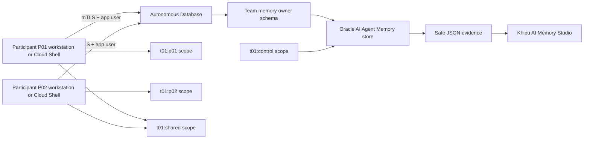

# Guía de facilitación: Workshop 1 — economía de tokens y memoria de decisiones

> Para los guiones orales listos para usar durante cada ejecución y la explicación del código archivo por archivo, consulta [Guiones de facilitación: ejecución y lectura del código](02-execution-and-code-speeches.md).

## Resultado esperado

Cada participante ejecuta Oracle AI Agent Memory SDK contra la ADB del trial de su equipo con un usuario temporal de aplicación. Persiste decisiones sintéticas, recupera el alcance asignado y ejecuta dos inferencias reales de OCI Generative AI para comparar telemetría de tokens y latencia. El dashboard visualiza evidencia segura; no reemplaza la ejecución.

## Topología aprobada

La unidad de despliegue es **un trial por equipo**. No se necesita un trial nuevo para la facilitadora: el trial actual se reserva para ensayo técnico. Cada equipo nuevo usa el mismo artefacto Terraform parametrizado.



La ADB, el memory store y sus objetos administrados se crean una vez. Cada participante trabaja desde su máquina con un usuario de aplicación distinto. El alcance es una frontera real de recuperación, pero no sustituye una política de seguridad por fila.

## Roles

| Rol | Responsabilidad | No debe hacer |
| --- | --- | --- |
| Facilitador de plataforma | Crear trial, revisar Terraform, descargar wallet y ejecutar bootstrap único | Compartir `ADMIN`, wallet maestro o contraseñas |
| Memory owner | Crear store una vez y conceder acceso de runtime | Ejecutar el ejercicio participante como owner |
| Participante | Ejecutar SDK, modificar datos sintéticos y generar evidencia | Crear objetos de Agent Memory, ejecutar Terraform o usar credenciales ajenas |
| Observador técnico | Revisar dashboard y controles | Ejecutar con usuario de otra persona |

## Prework por trial de equipo

El procedimiento completo y la lista de salida se encuentran en el [prework operativo](01-decision-memory-prework.md). Usa también el [roster privado de participantes](lab01-participant-roster.csv.example) para controlar preparación sin registrar secretos.

### 1. Crear el trial y ejecutar preflight

La creación del trial se hace fuera de Terraform. Después usa [`terraform/environments/trial-team`](../../terraform/environments/trial-team/). El primer plan debe crear solo el compartment; ADB, Object Storage y políticas IAM empiezan deshabilitados.

Antes de habilitar ADB, confirma región, crédito, cuota, código de equipo, tags y plan exacto. La creación de ADB consume créditos y requiere aprobación explícita.

### 2. Crear ADB y manejar el wallet

Después del `apply` aprobado, descarga un wallet mTLS para el trial. No uses Terraform para descargar o guardar el wallet: su contenido quedaría en el estado. Conserva wallet y contraseñas en un canal privado aprobado y elimina la distribución al cierre.

### 3. Crear identidades de base de datos

Como administrador de ADB, ejecuta una vez:

```sql
@platform/bootstrap/02_create_agent_memory_owner.sql T01
@platform/bootstrap/03_create_agent_memory_application_user.sql T01 P01
@platform/bootstrap/03_create_agent_memory_application_user.sql T01 P02
```

Repite el segundo script por participante. Las contraseñas se solicitan ocultas y no se incluyen en el repositorio ni como argumentos.

### 4. Provisionar el paquete y crear el memory store una sola vez

Sigue la sección 4 del [prework operativo](01-decision-memory-prework.md): desde PowerShell, con las referencias de owner configuradas, ejecuta:

```powershell
.\.venv\Scripts\python.exe .\labs\lab01_agent_memory\scripts\bootstrap_team_memory.py --team-code T01
```

Escribe `BOOTSTRAP` solo tras verificar ADB, equipo y store. El script primero provisiona el paquete oficial `DBMS_AGENT_MEMORY_STORE` en el esquema propietario mediante la conexión mTLS; después crea o abre el store con `SchemaPolicy.CREATE_IF_NECESSARY` y siembra una regla sintética en `t01:control`.

Esta es una operación de plataforma que se ejecuta una única vez por trial de equipo y exclusivamente con el usuario propietario. Ningún participante ejecuta este paso ni usa una política de creación.

### 5. Conceder acceso de runtime

Conéctate como memory owner y ejecuta por cada usuario de aplicación:

```sql
@platform/bootstrap/04_grant_agent_memory_runtime_access.sql OAM_T01_P01 OAMT01
@platform/bootstrap/04_grant_agent_memory_runtime_access.sql OAM_T01_P02 OAMT01
```

El script concede DML únicamente sobre las tablas administradas del store, lectura del property graph, lectura de la tabla de registro `AGENT_MEMORY_STORES` y `EXECUTE` sobre el paquete público `DBMS_AGENT_MEMORY_STORE`. La lectura del registro permite que el SDK valide el store existente entre esquemas; no concede administración. Tampoco concede privilegios `CREATE`, acceso al paquete interno ni permisos de administración de ADB. Los participantes usan después `SchemaPolicy.REQUIRE_EXISTING`.

### 6. Reducir permisos y entregar sesiones individuales

Tras completar los grants de todos los participantes, sigue la sección 6 del prework para revocar los privilegios temporales de instalación del memory owner. Luego prepara una sesión OCI propia y un archivo de sesión `.ps1` privado por participante conforme a la sección 8 del prework.

Cada participante recibe de forma privada:

- Wallet/directorio mTLS y contraseña.
- Usuario de aplicación y contraseña temporal.
- Archivo de sesión con las referencias no secretas requeridas por el launcher.
- Código `TNN` y `PNN`.

No entregues un único usuario para el equipo. No incluyas wallets, contraseñas ni sesiones privadas en el ZIP de código, GitHub, Object Storage público ni el dashboard.

### 7. Ensayar y declarar go/no-go

Una persona de ensayo debe completar la guía de participante con un usuario de aplicación, nunca con `ADMIN` ni con el owner. Declara **go** solo si obtiene:

```text
LAB01_OCI_SDK_READY
SCHEMA_POLICY REQUIRE_EXISTING
PERSISTENCE_CONFIRMED True
ISOLATION_PASS True
TOKEN_QUALITY_PASS True
```

Antes de aceptar el ensayo, confirma también que el JSON contiene dos bloques de `usage` de OCI y que `memory_optimized.prompt_tokens` es menor que `baseline.prompt_tokens`. El ensayo de inferencia usa exactamente dos llamadas on-demand con datos sintéticos; ejecútalo con un usuario de aplicación no administrador y dentro del presupuesto aprobado.

## Guion de 180 minutos

| Minutos | Facilitador | Participantes | Evidencia |
| --- | --- | --- | --- |
| 0–20 | Explica el caso, seguridad y los dos diseños de contexto | Identifican la regla procedural relevante | Vista previa del dashboard |
| 20–40 | Explica el SDK y acompaña preflight | Validan sesión, wallet, ADB y Memory Store sin inferencia | `LAB01_PREFLIGHT_COMPLETE` |
| 40–65 | Facilita la primera regla sintética | Persisten, recuperan y aíslan `payment-idempotency` en ADB sin inferencia | JSON de memoria 1 |
| 65–80 | Facilita la segunda regla sintética | Persisten y recuperan `contract-compatibility`; contrastan ambos resultados | JSON de memoria 2 |
| 80–95 | Conecta memoria con arquitectura de agentes | Ubican recuperación, composición de contexto, inferencia y acción en el ciclo del agente | Explicación técnica acordada |
| 95–120 | Da soporte a la corrida final | Ejecutan exactamente dos llamadas OCI para baseline vs. memoria | JSON de tokens seguro |
| 120–155 | Abre dashboard y facilita lectura comparativa | Analizan tokens, latencia, calidad y sus límites | Cuatro hitos del dashboard |
| 155–180 | Cierra y atiende incidencias | Sintetizan aprendizajes | Lista de cierres por participante |

## Mensaje técnico obligatorio

1. `CREATE_IF_NECESSARY` corresponde al owner y se ejecuta una vez; no debe ejecutarse en paralelo. El participante solo usa `REQUIRE_EXISTING`.
2. Los participantes llaman realmente a `OracleAgentMemory.add_memory(..., memory_type="guideline")` y a `search(..., exact_user_match=True, record_types=["guideline"])` contra ADB. El tipo de registro hace explícito que el resultado recuperado es una regla procedural. Para mantener el comportamiento de `KEYWORD` reproducible, el bundle separa pregunta de negocio y término de recuperación; en Payments, `idempotency` debe devolver `payment-idempotency`.
3. Una búsqueda con `user_id` exacto limita la recuperación, pero no autoriza por sí sola a un cliente que pueda modificar el identificador. Producción requiere servicio autenticado, IAM, red y controles de base de datos.
4. Antes de la comparación final, cada participante ejecuta un ejercicio real de memoria sin inferencia. El launcher permite solo `payment-idempotency` o `contract-compatibility`, persiste y recupera la regla elegida desde ADB y guarda evidencia segura. La simulación visual del dashboard se rotula explícitamente como local y no conectada.
5. La segunda recuperación usa `contract-compatibility` y conserva evidencia separada. Permite demostrar que la memoria no es una regla fija ni una simulación, sin añadir llamadas al modelo.
6. La discusión de arquitectura ubica Agent Memory antes de la inferencia: recuperación scoped, composición de contexto, OCI Generative AI y, fuera del alcance de Lab 1, una posible herramienta o acción.
7. La comparación final hace dos llamadas reales, equivalentes y acotadas al mismo modelo OCI. El dashboard presenta los tokens de entrada, salida, total y latencia devueltos por el proveedor. La reducción de tokens de entrada no equivale por sí sola al costo total de la solución.
8. Lab 1 usa `KEYWORD` para disminuir prerequisitos. Lab 2 incorporará embeddings y ADB Vector Search.

## Guion técnico del dashboard, los experimentos y SQL

### Separación que debe quedar explícita

El dashboard no es el runner. El participante ejecuta el runner desde PowerShell, este se conecta a ADB y, cuando corresponde, realiza solicitudes a OCI Generative AI. Al terminar, produce un JSON seguro de evidencia. El dashboard únicamente lee ese JSON y lo presenta; cargarlo o seleccionarlo no vuelve a ejecutar el SDK, no solicita contraseñas y no consume inferencias.

La pestaña **Mi evidencia real** es la fuente para afirmar que hubo persistencia, recuperación aislada y telemetría OCI. La pestaña **Simulador docente** es deliberadamente local: no consulta ADB ni OCI, no usa el SDK, no modifica el JSON y no genera evidencia.

### Cómo facilitar el simulador docente

El simulador crea un `ScopedMemoryStore` efímero en la sesión del navegador con reglas sintéticas. Su propósito es hacer visible el algoritmo antes o después de la ejecución real, sin exponer credenciales ni repetir inferencias.

| Control del dashboard | Qué hace | Qué no hace |
| --- | --- | --- |
| Selector de equipo y pregunta | Cambia el escenario visual y el alcance sintético mostrado | No cambia la evidencia real ni ejecuta una consulta contra ADB |
| **Mostrar recuperación simulada** | Revela la regla sintética que el algoritmo local recuperaría para la pregunta | No persiste ni recupera memoria real |
| **Comprobar aislamiento simulado** | Muestra que una regla de otro scope no aparece en el scope seleccionado | No prueba autorización de producción |
| **Reiniciar demostración** | Limpia el estado visual efímero del navegador | No borra ADB, evidencia ni recursos OCI |

Las cifras del simulador son estimaciones locales de diseño. No son telemetría de OCI, no representan facturación y no deben compararse con los tokens de la corrida real. En la implementación docente la consulta interna es intencionalmente determinista para que el concepto sea reproducible; cambiar una pregunta en el selector no vuelve a ejecutar el runner ni cambia los resultados ya medidos. Dilo de forma explícita si alguien espera que el selector dispare una nueva consulta real.

### Cómo leer la pestaña de experimentos reales

La pestaña **Experimentos reales** consume el JSON generado con `-ContextExperiment`. El runner persiste un catálogo sintético de procedimientos, recupera la regla líder mediante `KEYWORD`, comprueba que el scope de control no es visible y hace cuatro solicitudes OCI controladas. Se conserva la misma pregunta, modelo, límite de salida y criterio de calidad; solo cambia el contexto procedimental enviado al modelo:

1. Catálogo completo como baseline.
2. Solo la regla recuperada.
3. Regla relevante más distractores.
4. Contexto de pago y riesgo.

La lectura correcta es comparar por variante los tokens de entrada, salida, total, latencia y el resultado de calidad. `retrieved-top-1` suele ser la variante con menor contexto porque envía solo la decisión relevante; no es una garantía universal de menor costo o latencia. `QUALITY_PASS True` valida requisitos sintéticos mínimos de la respuesta, no sustituye una evaluación de exactitud, seguridad o utilidad de producción. La evidencia de una corrida validada mostró una reducción de 224 tokens de entrada con `retrieved-top-1`; úsala como observación del laboratorio, no como una promesa general.

### Diseño y evaluación de una regla propia

La pestaña **Diseño y evaluación** presenta la evidencia de la actividad de procedimiento propio. El participante trabaja en una copia privada de un JSON sintético, lo valida, lo persiste en su scope individual y ejecuta recuperación dirigida, amplia y de control negativo. Esta actividad no llama a OCI Generative AI: enseña que la calidad del contexto empieza con la forma de escribir, versionar, etiquetar y recuperar una decisión, antes de optimizar prompts.

### Inspección SQL de solo lectura

La actividad SQL sirve para conectar el comportamiento del SDK con el modelo físico, sin dar privilegios de administración al participante. Antes de iniciar SQLcl, en una PowerShell nueva se debe validar o restaurar el acceso temporal al cliente:

```powershell
if (-not (Get-Command sql -ErrorAction SilentlyContinue)) {
    $env:Path = "C:\Tools\sqlcl\bin;$env:Path"
}
sql -V
```

Después se carga la sesión privada, se configura `TNS_ADMIN`, se conecta con el usuario temporal de aplicación y se ejecuta el script sin argumentos:

```powershell
. $participantSession
$env:TNS_ADMIN = $env:LAB01_WALLET_DIR
sql "$env:LAB01_DB_USER@$env:LAB01_DB_DSN"
@labs/lab01_agent_memory/sql/inspect_memory_store.sql
```

Cuando SQLcl solicite valores, la facilitadora entrega únicamente el owner lógico y el prefijo del store. El script inspecciona metadatos mediante `ALL_TABLES` y `ALL_TAB_COLUMNS`; no ejecuta DDL ni DML. Las ocho tablas ya fueron creadas una sola vez durante el bootstrap del owner. La tabla principal `OAMT01_MEMORY` expone el registro lógico: identificador y orden, scope (`USER_ID`, `AGENT_ID`, `SPACE_ID`), tipo, contenido, metadatos, vigencia, estado y auditoría de creación. `OAMT01_RECORD_CHUNKS` apoya contenido recuperable; las tablas de documentos, enlaces, perfiles e hilos permiten otros patrones del SDK.

## Fallas previsibles

| Señal | Causa probable | Acción segura |
| --- | --- | --- |
| `LAB01_SESSION_NOT_READY` | Wallet, entorno virtual o sesión faltante | Revisar el material privado; no pedir publicar wallet |
| Error al crear `OracleAgentMemory` como app user | Store, paquete propietario o grants faltantes | Corregir con owner; verificar `EXECUTE` sobre el paquete público y `SELECT` sobre `AGENT_MEMORY_STORES`; no reemplazar por `ADMIN` |
| Error mTLS / `tnsnames.ora` | Ruta de wallet equivocada | Redistribuir wallet privado; no copiar al repo |
| `ISOLATION_PASS False` | Error de algoritmo, bundle o control scope | Detener publicación compartida y revisar datos sintéticos |
| Recuperación procedural vacía | El término `KEYWORD` no aparece en la regla | Revisar `retrieval_query` y usar una palabra explícita de la regla, por ejemplo `idempotency`; no cambiar la política ni usar `ADMIN` |
| `MEMORY_PROMPT_TOKENS` no es menor | El bundle recuperó demasiadas decisiones o el modelo no devolvió uso comparable | Detener el cierre de evidencia, revisar el bundle y el modelo aprobado; no presentar resultados locales como medición OCI |
| Error de uso o respuesta truncada | El modelo no devolvió el bloque `usage`, faltan permisos o el límite es insuficiente | Validar el modelo durante preflight; no sustituir por estimaciones locales |
| `sql` no se reconoce | SQLcl no está en el `PATH` de la ventana actual | Ejecutar el bloque temporal de `PATH` de la sección SQL y validar con `sql -V`; no modificar el `PATH` global durante el workshop |
| `ORA-01425` al inspeccionar tablas | Una versión anterior del script tenía un patrón `LIKE ... ESCAPE` incompatible | Actualizar el clon con `git pull --ff-only` y volver a ejecutar el script; no editar el SQL manualmente durante la sesión |
| `401 INVALID_AUTHENTICATION_INFO` durante inferencia | La sesión OCI expiró o el token no pertenece al tenant del workshop | Validar la sesión, reautenticar con la identidad asignada y repetir preflight; no recrear wallet, ADB ni el memory store |
| `git pull --ff-only` bloqueado por cambios locales | El participante modificó un archivo versionado | Guardar el cambio de forma recuperable con `git stash push -m "local-guide-backup" -- <file>` y repetir el pull; no usar `git reset --hard` |

## Cierre y limpieza

Guarda solo JSON de evidencia sin secretos. Invalida credenciales temporales, retira wallets y elimina usuarios de aplicación únicamente con aprobación explícita. La destrucción de ADB, compartment o recursos Terraform se revisa y aprueba como actividad separada, nunca durante el laboratorio.

## Preparación de participantes pendientes

Mientras se esperan los correos, usa la [matriz privada de asignación](participant-roster-template.md), la [lista privada de onboarding](participant-onboarding-private-checklist.md) y el [procedimiento de preparación de espacios](participant-workspace-preparation.md). Se pueden preparar directorios y plantillas sin identidad, pero la creación de usuarios ADB, identidades OCI y sesiones autenticadas se realiza solo después de confirmar cada participante.
