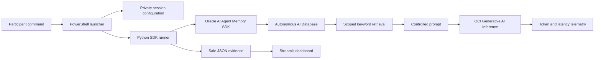
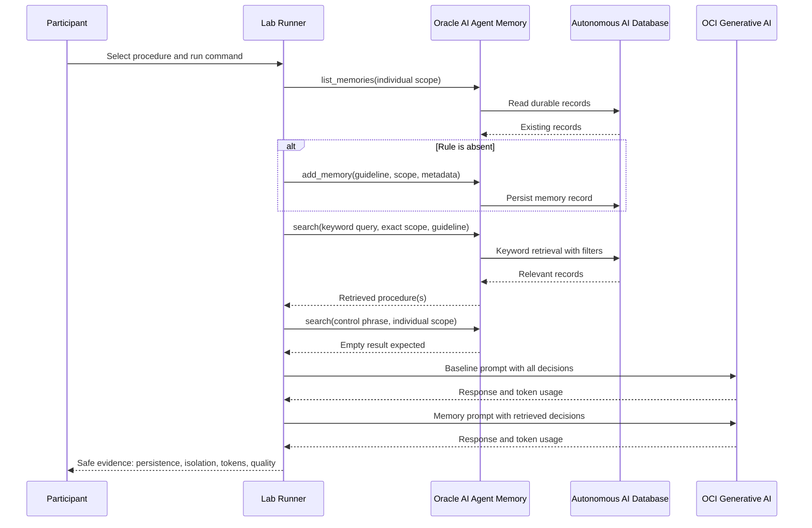

# Guiones de facilitación: ejecución y lectura del código — Workshop 1

> Documento privado de facilitación. Los bloques **Qué decir** están redactados para leerlos o adaptarlos durante la sesión. Los comandos son una referencia narrativa: cada participante debe usar exclusivamente el código, la ruta y el archivo privado que le fueron asignados.

## Propósito

Este runbook transforma la ejecución técnica del laboratorio en una historia didáctica. El objetivo no es que el público copie comandos sin contexto, sino que comprenda cuatro ideas:

1. La memoria persistente y la inferencia son operaciones diferentes.
2. El agente recupera contexto antes de invocar el modelo.
3. Recuperar solo la decisión pertinente puede reducir los tokens de entrada sin degradar la respuesta esperada.
4. La evidencia JSON permite separar una ejecución real de una simulación visual.

## Mensaje central de treinta segundos

### Qué decir

> En este laboratorio construiremos el ciclo mínimo de un agente con memoria gobernada. Primero persistiremos decisiones sintéticas en Oracle Autonomous AI Database mediante Oracle AI Agent Memory. Después recuperaremos únicamente el contexto relevante para una consulta y, finalmente, compararemos dos inferencias del mismo modelo: una con contexto completo y otra con memoria recuperada. No estamos probando solamente que el modelo responda; estamos midiendo qué contexto recibió, cuánto costó en tokens y si respetó el aislamiento asignado al participante.

## Mapa narrativo de la ejecución



La secuencia tiene tres planos que deben explicarse por separado:

- **Plano de identidad y acceso:** sesión OCI, perfil, grupo IAM, usuario temporal ADB y wallet.
- **Plano de memoria:** persistencia, recuperación, idempotencia y aislamiento lógico.
- **Plano de inferencia y evidencia:** llamadas al modelo, telemetría real y JSON seguro.

---

# Explicación técnica exacta del algoritmo de Agent Memory usado en Lab 1

## Qué es y qué no es

El laboratorio usa Oracle AI Agent Memory como un **store persistente de registros de memoria** sobre Autonomous AI Database. La aplicación escribe reglas procedurales sintéticas y luego recupera el subconjunto pertinente antes de construir un prompt para OCI Generative AI.

No es un mecanismo que aprenda autónomamente de cada conversación. En esta configuración, la extracción automática está deshabilitada con `MemoryExtractionConfig(extract_memories=False)`: una memoria solo existe cuando el código llama explícitamente a `add_memory()`.

Tampoco es una búsqueda vectorial en Lab 1. Se configura `SearchStrategy.KEYWORD`; por eso no se generan embeddings, no se consulta AI Vector Search y no se usa un reranker semántico. El Lab 2 introduce el patrón de embeddings y búsqueda vectorial.

## Algoritmo, paso por paso

1. **Construir el scope lógico.** El código deriva tres scopes deterministas: individual (`t01:pNN`), compartido (`t01:shared`) y de control (`t01:control`).
2. **Validar la infraestructura existente.** El participante abre el store con `SchemaPolicy.REQUIRE_EXISTING`. No puede inicializar el esquema ni crear tablas del store.
3. **Detectar duplicados.** Antes de escribir, el runner consulta los registros durables del scope individual con `list_memories(user_id=scope, limit=100)` y compara el contenido exacto de la regla.
4. **Persistir la regla si falta.** `add_memory()` escribe el contenido como `memory_type="guideline"`, asociado al `user_id` del scope, a un `agent_id` del laboratorio y a metadata de equipo, participante, procedimiento y carácter sintético.
5. **Recuperar una regla.** La consulta se ejecuta con el mismo `user_id`, `exact_user_match=True`, `record_types=["guideline"]` y `max_results=10`. El SDK realiza la estrategia de palabra clave configurada sobre los registros admisibles para ese scope.
6. **Probar el control negativo.** El runner busca una frase conocida del scope de control, pero la ejecuta dentro del scope individual. El resultado debe ser vacío.
7. **Construir el contexto de inferencia.** Para la comparación final, el código forma dos prompts con la misma pregunta e instrucción: el baseline recibe todas las decisiones del bundle; la variante memory recibe únicamente las recuperadas.
8. **Medir dos respuestas OCI reales.** Se conservan modelo, temperatura y límite de salida; únicamente cambia el contexto. La respuesta de OCI provee `prompt_tokens`, `completion_tokens`, `total_tokens` y el runner mide latencia.
9. **Validar y producir evidencia.** Ambas respuestas deben pasar el criterio mínimo de calidad. Solo entonces se calcula la reducción de tokens y se genera JSON seguro.



## Qué controla cada parámetro

| Parámetro | Efecto en el laboratorio |
| --- | --- |
| `SchemaPolicy.REQUIRE_EXISTING` | El participante usa un store ya inicializado; no modifica la estructura administrada. |
| `memory_store_id` | Selecciona el store preparado por la facilitadora. |
| `user_id` | Delimita el scope lógico que se usa para escribir y recuperar. |
| `exact_user_match=True` | Exige coincidencia exacta del scope solicitado durante recuperación. |
| `memory_type="guideline"` | Limita el ejercicio a reglas procedurales, no perfiles ni mensajes. |
| `SearchStrategy.KEYWORD` | Recuperación léxica por palabras clave en Lab 1. |
| `max_results=10` | Límite superior de registros devueltos al runner. |
| `extract_memories=False` | No hay extracción o aprendizaje automático a partir de conversaciones. |

## Límites técnicos que se deben declarar

- La idempotencia es del laboratorio: compara contenido exacto antes de insertar. No es una garantía transaccional para escrituras simultáneas de múltiples procesos.
- El control negativo demuestra aislamiento de recuperación dentro de este flujo. No demuestra por sí mismo seguridad por fila ni sustituye IAM, roles ADB, grants o controles de red.
- El criterio de calidad comprueba términos requeridos en la respuesta. Es un test funcional mínimo; no reemplaza una evaluación semántica, humana o basada en un juez de mayor rigor.
- La reducción de tokens se calcula en una corrida concreta y no equivale automáticamente a ahorro total de costo en producción. Deben considerarse almacenamiento, recuperación, latencia, caché, calidad y frecuencia de uso.
- El SDK abstrae el algoritmo interno exacto de ranking de `KEYWORD`. El contrato explícito del laboratorio es estrategia léxica, filtros, scope exacto, tipo de registro y límite de resultados; no se deben afirmar detalles de scoring no expuestos por el SDK.

## Respuesta corta para una pregunta en vivo

> El algoritmo del laboratorio no aprende solo ni envía todo el historial al modelo. Guarda reglas explícitas en Agent Memory, las etiqueta con un scope y metadata, filtra el scope exacto, recupera por palabras clave solo reglas `guideline` y usa esas reglas para armar un prompt más pequeño. Después compara, con el mismo modelo, los tokens y la calidad contra un prompt que contenía todo el contexto.

---

## Guion 1 — Apertura del caso

### Qué mostrar

La arquitectura del laboratorio y la primera pestaña del dashboard.

### Qué decir

> Imaginemos un agente que debe aplicar decisiones de ingeniería ya aprobadas: idempotencia de pagos, compatibilidad de contratos o trazabilidad de reembolsos. Si enviamos todo el historial en cada prompt, aumentan el ruido, los tokens y el riesgo de mezclar contextos. Si no guardamos memoria, el agente vuelve a resolver el mismo problema desde cero. La arquitectura que probaremos conserva decisiones durables, recupera solo las pertinentes y demuestra con telemetría qué efecto tuvo esa recuperación.

> Los datos son completamente sintéticos. No usaremos información de clientes, código interno, credenciales ni contratos reales. El laboratorio enseña el patrón técnico y sus controles, no una carga productiva.

### Pregunta al grupo

> ¿Qué decisiones de sus equipos se repiten hoy en tickets, documentos o conversaciones y podrían convertirse en memoria procedural gobernada?

---

## Guion 2 — Identidad, wallet y límites de seguridad

### Qué decir

> Aquí intervienen dos identidades distintas. La identidad OCI autoriza el acceso a OCI Generative AI. El usuario temporal de Autonomous Database autoriza la conexión al memory store. El wallet aporta la configuración criptográfica de la conexión mTLS, pero no sustituye la contraseña de base de datos. Ninguno de estos elementos se guarda en GitHub ni en la evidencia del dashboard.

> Cada participante recibe un código y un usuario ADB diferentes. El scope `t01:pNN` delimita la recuperación que realiza el laboratorio. Es importante no sobredimensionar este control: el scope es una frontera lógica de recuperación del SDK, no reemplaza controles productivos de autorización, roles de base de datos, políticas de acceso ni seguridad por fila.

### Validación visible

- La sesión OCI pertenece al tenancy del workshop.
- El wallet se encuentra fuera del repositorio.
- El usuario ADB es el asignado al participante.
- La sesión privada no se comparte ni se publica.

---

## Guion 3 — Preflight individual

### Antes del comando: qué decir

> El preflight no persiste memoria y no llama al modelo. Su propósito es fallar temprano y de forma explícita. Verifica el launcher, el wallet, la configuración del memory store, el tenancy, la conectividad ADB, el acceso al modelo y la construcción del cliente de inferencia. Si este bloque no termina en `LAB01_PREFLIGHT_COMPLETE`, no seguimos con el laboratorio.

### Comando de referencia

```powershell
powershell -ExecutionPolicy Bypass -File .\labs\lab01_agent_memory\scripts\run_participant_live.ps1 `
  -TeamCode $teamCode `
  -ParticipantCode $participantCode `
  -SessionFile $participantSession `
  -Preflight
```

### Después del comando: qué decir

> Las líneas `DATABASE_ACCESS True`, `MEMORY_STORE_ACCESS True` y `MODEL_ACCESS True` prueban tres fronteras distintas. La primera valida credenciales y red hacia ADB. La segunda confirma que el usuario puede utilizar el store ya aprovisionado. La tercera confirma que la identidad OCI puede descubrir el modelo autorizado en la región correcta. `NO_INFERENCE` demuestra que ninguna llamada de generación fue necesaria para realizar estas validaciones.

### Señal de avance

```text
LAB01_OCI_TENANCY_MATCH True
LAB01_PREFLIGHT_DATABASE_ACCESS True
LAB01_PREFLIGHT_MEMORY_STORE_ACCESS True
LAB01_PREFLIGHT_MODEL_ACCESS True
LAB01_PREFLIGHT_INFERENCE_CLIENT_READY True
LAB01_PREFLIGHT_COMPLETE
```

---

## Guion 4 — Primera memoria: `payment-idempotency`

### Antes del comando: qué decir

> Ahora ejecutaremos memoria real sin inferencia. Persistiremos una decisión procedural sintética, la recuperaremos mediante búsqueda por palabras clave y comprobaremos que el scope de control no aparece en los resultados del participante. Esta fase llama a ADB, pero realiza cero llamadas a OCI Generative AI.

### Comando de referencia

```powershell
powershell -ExecutionPolicy Bypass -File .\labs\lab01_agent_memory\scripts\run_participant_live.ps1 `
  -TeamCode $teamCode `
  -ParticipantCode $participantCode `
  -SessionFile $participantSession `
  -MemoryExercise payment-idempotency
```

### Durante la salida: qué decir

> `PERSIST` escribe una guía procedural en el scope individual. `RETRIEVE` busca la decisión pertinente. `ISOLATE` intenta comprobar que una decisión del scope de control no sea visible. La ejecución es idempotente: si repetimos el mismo procedimiento, el código detecta el registro existente en lugar de crear duplicados.

### Después del comando: qué decir

> `PERSISTENCE_CONFIRMED True` prueba durabilidad en ADB. `ISOLATION_PASS True` demuestra el límite de recuperación configurado. `NO_OCI_INFERENCE True` separa explícitamente el comportamiento de memoria del comportamiento del modelo. Esta separación es fundamental para diagnosticar sistemas de agentes: un fallo de recuperación no debe confundirse con un fallo de generación.

---

## Guion 5 — Segunda memoria: `contract-compatibility`

### Qué decir

> Repetimos el patrón con una decisión diferente para comprobar que el store contiene conocimiento procedural reutilizable y no una respuesta codificada para un único ejemplo. El algoritmo sigue siendo el mismo: persistir si no existe, recuperar por términos relevantes, validar el scope y generar evidencia segura.

### Comando de referencia

```powershell
powershell -ExecutionPolicy Bypass -File .\labs\lab01_agent_memory\scripts\run_participant_live.ps1 `
  -TeamCode $teamCode `
  -ParticipantCode $participantCode `
  -SessionFile $participantSession `
  -MemoryExercise contract-compatibility
```

### Pregunta al grupo

> ¿Qué parte del comportamiento permanece estable y qué parte cambia al introducir un nuevo procedimiento?

### Respuesta esperada

Permanece estable el pipeline de memoria, el scope, la búsqueda, los controles y la evidencia. Cambian el contenido procedural, sus términos de activación y la consulta de recuperación.

---

## Guion 6 — Comparación real de dos inferencias

### Antes del comando: qué decir

> Esta es la comparación principal. El código ejecutará exactamente dos llamadas on-demand al mismo modelo, con la misma pregunta y parámetros deterministas. La única variable experimental será el contexto: la variante baseline recibe el conjunto completo de decisiones; la variante memory recibe únicamente las decisiones recuperadas. Así podemos atribuir la diferencia de tokens de entrada a la estrategia de contexto, no a un cambio de modelo o temperatura.

### Comando de referencia

```powershell
powershell -ExecutionPolicy Bypass -File .\labs\lab01_agent_memory\scripts\run_participant_live.ps1 `
  -TeamCode $teamCode `
  -ParticipantCode $participantCode `
  -SessionFile $participantSession
```

### Durante la salida: qué decir

> `BASELINE_PROMPT_TOKENS` es el contexto amplio. `MEMORY_PROMPT_TOKENS` es el contexto recuperado. `INPUT_TOKEN_REDUCTION` es la diferencia observada en esta ejecución. `TOKEN_QUALITY_PASS True` indica que ambas respuestas conservaron los marcadores mínimos de calidad definidos por el laboratorio.

### Después del comando: qué decir

> La conclusión correcta no es que la memoria siempre reduce costos en cualquier escenario. La conclusión es que, en esta prueba controlada, recuperar contexto pertinente redujo los tokens de entrada y mantuvo el criterio de calidad. En producción debemos medir además precisión de recuperación, calidad, latencia total, costo de almacenamiento, caducidad, actualización y riesgos de memoria obsoleta.

### Preguntas al grupo

- ¿Cuántos tokens se eliminaron del prompt?
- ¿La respuesta con memoria mantuvo el criterio de calidad?
- ¿Qué riesgo tendría recuperar una decisión incorrecta aunque el prompt fuera más corto?

---

## Guion 7 — Experimento de economía de contexto

### Qué decir

> Ahora ampliamos la comparación a cuatro variantes controladas. Queremos observar la curva entre contexto disponible, tokens consumidos y calidad. El experimento no busca premiar siempre al prompt más corto; busca encontrar la variante mínima que todavía conserva la información necesaria para responder correctamente.

### Comando de referencia

```powershell
powershell -ExecutionPolicy Bypass -File .\labs\lab01_agent_memory\scripts\run_participant_live.ps1 `
  -TeamCode $teamCode `
  -ParticipantCode $participantCode `
  -SessionFile $participantSession `
  -ContextExperiment
```

### Cómo interpretar

> `EXPERIMENT_VARIANTS 4` confirma las cuatro llamadas reales. `LOWEST_INPUT_VARIANT` identifica la variante con menos tokens de entrada entre las que se ejecutaron. `LOWEST_INPUT_REDUCTION` cuantifica la reducción respecto del contexto de referencia. `QUALITY_PASS True` evita declarar ganadora una variante corta que perdió la información esencial.

---

## Guion 8 — Diseño de una regla propia

### Qué decir

> El participante deja de ser operador del ejemplo y pasa a diseñar una memoria. Define un identificador estable, dominio, términos de activación, procedimiento y evidencia requerida. El archivo debe contener solo información sintética. Después validamos su contrato, persistimos la regla y probamos tres consultas: dirigida, amplia y control negativo.

### Comando de referencia

```powershell
powershell -ExecutionPolicy Bypass -File .\labs\lab01_agent_memory\scripts\run_participant_live.ps1 `
  -TeamCode $teamCode `
  -ParticipantCode $participantCode `
  -SessionFile $participantSession `
  -CustomProcedure $customProcedure
```

### Qué explicar de las tres consultas

- **Targeted:** utiliza términos suficientemente específicos y debe recuperar la regla.
- **Broad:** reduce precisión deliberadamente para discutir ambigüedad y ruido.
- **Negative control:** usa un tema no relacionado y no debe recuperar la regla.

### Mensaje de gobierno

> Una memoria de calidad necesita propietario, versión, vigencia, clasificación, evidencia y criterio de retiro. Persistir texto no es gobernar conocimiento. El diseño del registro es tan importante como el algoritmo de recuperación.

---

## Guion 9 — Inspección SQL de solo lectura

### Qué decir

> Esta inspección no modifica el store. Nos permite conectar la abstracción del SDK con el modelo persistente en Oracle Database. El usuario temporal ve únicamente la metadata autorizada mediante los grants preparados por la facilitadora.

> Las ocho tablas pertenecen al store administrado por Oracle AI Agent Memory; no se crean ocho tablas por participante. Los participantes comparten el store, mientras que el usuario, el agente y el space permiten representar contextos y alcances distintos.

### Lectura conceptual de las tablas

- `*_MEMORY`: registro principal de memoria, contenido, tipo, scope, estado y metadata.
- `*_RECORD_CHUNKS`: unidades recuperables derivadas de registros extensos.
- `*_DOCUMENT`: documentos asociados a patrones de memoria documental.
- `*_MEMORY_LINK`: relaciones entre memorias o entidades.
- `*_ACTOR_PROFILE`: perfiles de actores utilizados por patrones del SDK.
- `*_MESSAGE`: mensajes asociados a interacciones conversacionales.
- `*_THREAD`: agrupación de mensajes e interacciones.
- `*_THREAD_SUMMARY`: resúmenes persistentes de hilos.

### Mensaje técnico

> En este workshop utilizamos principalmente memoria procedural de tipo `guideline` y búsqueda `KEYWORD`. Las tablas adicionales muestran que el modelo puede soportar otros patrones. No debemos interpretar su presencia como que todos esos patrones estén activos en esta ejecución.

---

## Guion 10 — Evidencia y dashboard

### Qué decir

> El dashboard no ejecuta el SDK, no consulta credenciales y no llama al modelo. Lee un JSON seguro generado previamente por el runner. Ese archivo contiene resultados, telemetría y banderas de validación, pero declara expresamente que no contiene secretos.

> En **Mi evidencia real** debemos distinguir tres tipos de artefacto: evidencia de memoria sin inferencia, comparación real de dos llamadas y experimento de cuatro variantes. Seleccionar una pregunta en el simulador no vuelve a ejecutar OCI; solo cambia la representación didáctica local.

### Qué revisar en la evidencia real

- Equipo y scope del participante.
- Procedimientos persistidos y recuperados.
- Persistencia e aislamiento confirmados.
- Proveedor y modelo utilizados.
- Tokens baseline y memory.
- Reducción observada.
- Latencia y criterio de calidad.
- Ruta y tipo de evidencia.

### Advertencia que debe decirse

> Un archivo JSON cualquiera no es aceptado como evidencia. El dashboard valida un esquema conocido, ausencia declarada de secretos, persistencia, aislamiento y telemetría coherente. Visualizar evidencia no equivale a confiar ciegamente en ella; el esquema y las invariantes forman parte del control.

---

## Guion 11 — Simulador docente

### Qué decir

> La pestaña **Simulador docente** es una demostración determinista en memoria local. No consulta ADB, no usa el SDK de Oracle AI Agent Memory, no llama a OCI Generative AI y no genera evidencia real. Sirve para pausar la sesión y explicar visualmente cómo una consulta se compara con reglas, cómo cambia el resultado al elegir otro escenario y por qué un control negativo importa.

> El botón de recuperación simulada modifica únicamente el estado local de la interfaz. Reiniciar demostración restaura ese estado. Estas acciones son pedagógicas; no deben presentarse como una validación de infraestructura o de seguridad.

---

## Guion 12 — Cierre arquitectónico

### Qué decir

> Hoy validamos un patrón completo: identidad separada, conexión segura a Autonomous AI Database, memory store persistente, escritura idempotente, recuperación con scope, control negativo, inferencia con OCI Generative AI y evidencia medible. El valor no está únicamente en reducir tokens. Está en convertir decisiones repetibles en contexto gobernado, observable y recuperable.

> Para llevar este patrón a producción faltan decisiones explícitas: autorización fuerte, ciclo de vida y expiración de memoria, calidad de recuperación, auditoría, datos sensibles, evaluación continua, alarmas, límites de consumo y separación de ambientes. El workshop demuestra la base técnica sobre la cual se construyen esos controles.

### Pregunta final

> ¿Qué decisión real elegirían como primer caso piloto y qué evidencia exigirían antes de permitir que un agente la utilice?

---

# Speech de lectura del código, paso a paso

> Para una versión con fragmentos reales y anotaciones técnicas detalladas, abre [Lab 1 — Código anotado](03-lab01-annotated-code.md).

## 1. `run_participant_live.ps1` — orquestador y guardrail

### Qué mostrar

`labs/lab01_agent_memory/scripts/run_participant_live.ps1`

### Qué decir

> Este script es la única entrada del participante. Primero recibe `TeamCode`, `ParticipantCode` y `SessionFile`. Después carga la configuración privada en el proceso actual, valida que existan Python, el wallet, el runner y las variables requeridas, y elige un solo modo de ejecución. La exclusión entre `Preflight`, `MemoryExercise`, `ContextExperiment` y `CustomProcedure` evita mezclar pruebas con semánticas y costos diferentes.

> El launcher nunca imprime contraseñas. Las claves se solicitan dentro del proceso Python mediante entrada oculta. La evidencia se escribe bajo `artifacts/lab01/<team>/<participant>` y contiene únicamente campos permitidos.

### Puntos de código que señalar

1. Declaración de parámetros y switches.
2. Carga del archivo privado con dot-sourcing.
3. Validación de rutas y variables.
4. Selección mutuamente exclusiva del modo.
5. Invocación de Python desde `.venv`.
6. Propagación del código de salida.

## 2. `run_participant_sdk_lab.py` — composición del runtime

### Qué mostrar

`labs/lab01_agent_memory/scripts/run_participant_sdk_lab.py`

### Qué decir

> El runner Python ensambla los clientes reales. Lee configuración no secreta del entorno, solicita en memoria la contraseña ADB y la contraseña del wallet, crea el pool `oracledb` y construye `OracleAgentMemory`. Observe dos decisiones: `SchemaPolicy.REQUIRE_EXISTING` impide que el participante aprovisione o altere el store; `SearchStrategy.KEYWORD` hace explícito que Lab 1 no usa embeddings.

> El owner ya ejecutó `CREATE_IF_NECESSARY` durante el prework. El participante solo consume el store existente. Esta separación reduce privilegios y evita que una corrida del workshop cambie el esquema compartido.

### Puntos de código que señalar

1. `required_environment()` valida configuración obligatoria.
2. `create_runtime_memory()` crea pool y objeto de memoria.
3. `build_oci_signer()` utiliza el perfil y token de sesión asignados.
4. `validate_tenancy_binding()` evita usar accidentalmente otro tenant.
5. `validate_model_access()` comprueba acceso y disponibilidad sin inferencia.
6. `run_preflight()` agrupa validaciones de cero llamadas.
7. `main()` dirige cada modo y escribe su evidencia.

## 3. `sdk_exercise.py` — persistencia, recuperación e aislamiento

### Qué mostrar

`labs/lab01_agent_memory/src/lab01_agent_memory/sdk_exercise.py`

### Qué decir

> Aquí reside el corazón del ejercicio de memoria. El código construye scopes deterministas: individual, compartido y control. Antes de insertar busca una memoria equivalente; por eso la operación es idempotente. Al escribir usa `memory_type="guideline"` y agrega metadata sintética, equipo, participante y `procedure_id`.

> La recuperación exige coincidencia exacta del usuario lógico, filtra por registros `guideline` y limita la cantidad de resultados. Luego ejecuta un intento de acceso cruzado contra el scope de control. La evidencia final registra tanto el resultado positivo como la prueba negativa.

### Puntos de código que señalar

1. Construcción de scopes.
2. Detección de registros existentes.
3. `add_memory()` con tipo y metadata.
4. `search()` con aislamiento y filtros.
5. Validación de control negativo.
6. Construcción de evidencia sin secretos.

## 4. `inference.py` — experimento controlado

### Qué mostrar

`labs/lab01_agent_memory/src/lab01_agent_memory/inference.py`

### Qué decir

> Este módulo mantiene constante el sistema experimental. `build_prompt()` usa la misma instrucción y pregunta; únicamente sustituye el bloque de decisiones. `_run_variant()` captura texto, tokens y latencia reportados por OCI. `run_token_comparison()` ejecuta baseline y memory, valida calidad mínima y calcula la reducción. `run_context_experiment()` generaliza la prueba a cuatro contextos.

> El adaptador de OCI usa `CohereChatRequest`, temperatura cero, un máximo controlado de salida y `OnDemandServingMode`. La telemetría proviene de la respuesta real del servicio; no se estima contando palabras localmente.

### Puntos de código que señalar

1. Instrucción de sistema común.
2. Construcción del prompt.
3. Configuración determinista del modelo.
4. Captura de usage y latencia.
5. Validación de calidad.
6. Cálculo de reducción y elección de variante.

## 5. `custom_procedure_lab.py` — evaluación de una memoria diseñada

### Qué mostrar

`labs/lab01_agent_memory/src/lab01_agent_memory/custom_procedure_lab.py`

### Qué decir

> Este archivo convierte el JSON del participante en un experimento de recuperación. Valida el contrato, persiste si la versión no existe y genera consultas dirigida, amplia y negativa a partir de los términos de activación. La meta no es que cualquier consulta recupere la regla; la meta es que una consulta pertinente la encuentre y una no relacionada no la encuentre.

## 6. `participant_evidence.py` — frontera de confianza del dashboard

### Qué mostrar

`labs/lab01_agent_memory/src/lab01_agent_memory/participant_evidence.py`

### Qué decir

> Este parser impide que el dashboard trate cualquier JSON como resultado válido. Reconoce versiones de esquema aprobadas, comprueba la declaración `contains_no_secrets`, valida persistencia, aislamiento y telemetría, y normaliza la información que verá la interfaz. Es una frontera de validación, no solo un lector de archivos.

## 7. `participant_lab.py` y `ui/app.py` — simulación frente a evidencia

### Qué decir

> `participant_lab.py` implementa el simulador docente local con un store en memoria. `ui/app.py` presenta tanto ese simulador como la evidencia real. La separación de ambos caminos es deliberada: uno explica el algoritmo sin dependencias; el otro interpreta una corrida ya ejecutada contra ADB y OCI.

---

# Guiones breves para incidencias

## Sesión OCI inválida o expirada

> El error ocurre antes de la lógica de memoria. Renovaremos la sesión con la identidad del participante y validaremos el perfil. No cambiaremos IAM ni reutilizaremos una sesión de otra persona.

## `401 NotAuthenticated`

> La solicitud llegó al servicio sin material de autenticación válido o con un token vencido. Primero validamos config, profile y security token; no asumimos que sea un problema del modelo.

## `404 NotAuthorizedOrNotFound` para modelos

> OCI combina autorización y ocultamiento de recursos en esta respuesta. Confirmaremos tenancy, región, grupo IAM, políticas y disponibilidad del modelo. No probaremos modelos al azar ni ampliaremos permisos sin diagnóstico.

## Error de wallet o ADB

> Separaremos tres causas: ruta o alias TNS incorrecto, contraseña del wallet incorrecta y credencial ADB incorrecta. El wallet no es la contraseña del usuario de base de datos.

## Memoria existente

> No es un fallo. La operación idempotente detectó que la decisión ya estaba persistida. Esto evita duplicados al repetir el laboratorio.

## Aislamiento falso

> Detenemos la ejecución. Un fallo de aislamiento invalida la evidencia y no debe compensarse ocultando el resultado en el dashboard.

## No hubo reducción de tokens

> El experimento no garantiza una reducción universal. Revisaremos si la recuperación devolvió contexto demasiado amplio, si la baseline ya era pequeña o si la regla no era selectiva. El resultado sigue siendo útil para ajustar la estrategia.

---

# Frases que no deben utilizarse

- No decir: “El dashboard ejecuta el agente”. Decir: “El dashboard interpreta evidencia segura ya generada”.
- No decir: “Cada participante crea ocho tablas”. Decir: “El store compartido tiene ocho tablas administradas; cada participante usa credenciales y scope propios”.
- No decir: “El scope es seguridad por fila”. Decir: “El scope es una frontera lógica de recuperación del laboratorio”.
- No decir: “Memory siempre reduce costos”. Decir: “La reducción debe medirse junto con calidad, precisión y latencia”.
- No decir: “Lab 1 es RAG vectorial”. Decir: “Lab 1 usa búsqueda por palabra clave; el laboratorio posterior introduce embeddings y AI Vector Search”.

---

# Versión condensada para una demostración de diez minutos

1. **Problema:** enviar todo el contexto en cada prompt es costoso y ruidoso.
2. **Preflight:** identidad, ADB, store y modelo listos; cero inferencias.
3. **Memoria:** persistir, recuperar y aislar una decisión; cero inferencias.
4. **Comparación:** mismo modelo y pregunta, contexto baseline frente a contexto recuperado; dos inferencias.
5. **Evidencia:** revisar tokens, calidad, latencia, persistencia y aislamiento en JSON seguro.
6. **Cierre:** memoria gobernada mejora la selección de contexto; producción exige autorización, ciclo de vida, evaluación y observabilidad.

---

# Inventario privado de documentación de facilitación

| Documento | Uso principal |
| --- | --- |
| [`00-clean-tenant-deployment.md`](00-clean-tenant-deployment.md) | Despliegue repetible desde un tenant limpio: compartment, Terraform, ADB, wallet, owner y validaciones. |
| [`01-decision-memory-prework.md`](01-decision-memory-prework.md) | Prework operativo lineal desde el tenant hasta la preparación del participante. |
| [`01-decision-memory.md`](01-decision-memory.md) | Runbook principal de la sesión: arquitectura, agenda, mensajes técnicos, dashboard, SQL, incidencias y cierre. |
| [`02-execution-and-code-speeches.md`](02-execution-and-code-speeches.md) | Guiones orales de ejecución y lectura del código archivo por archivo. |
| [`identity-domain-provisioning-private.md`](identity-domain-provisioning-private.md) | Creación, activación y control privado de identidades OCI y grupo IAM. |
| [`participant-onboarding-private-checklist.md`](participant-onboarding-private-checklist.md) | Checklist individual de identidad, ADB, runtime, wallet, sesión, preflight y entrega. |
| [`participant-roster-template.md`](participant-roster-template.md) | Matriz privada de asignación y estado por código de participante. |
| [`participant-workspace-preparation.md`](participant-workspace-preparation.md) | Preparación de directorios, archivo de sesión y wallet fuera del repositorio. |
| [`lab01-participant-roster.csv.example`](lab01-participant-roster.csv.example) | Esquema de ejemplo para una matriz operativa sin secretos. |
| [`../../labs/lab01_agent_memory/FACILITATOR_GUIDE.md`](../../labs/lab01_agent_memory/FACILITATOR_GUIDE.md) | Índice técnico corto con controles no negociables y señal de go/no-go. |

## Entregables editables adicionales

- [`../../artifacts/documents/Guia de Facilitacion Detallada Workshop 1.docx`](../../artifacts/documents/Guia%20de%20Facilitacion%20Detallada%20Workshop%201.docx): versión editable en español para presentación y notas.
- [`../../artifacts/documents/Workshop 1 Detailed Facilitation Guide.docx`](../../artifacts/documents/Workshop%201%20Detailed%20Facilitation%20Guide.docx): versión editable histórica en inglés.
- [`../../artifacts/documents/Workshop 1 Detailed Facilitation Guide.qa.pdf`](../../artifacts/documents/Workshop%201%20Detailed%20Facilitation%20Guide.qa.pdf): render de control de calidad de la versión documental.

## Orden recomendado de consulta

1. Antes de aprovisionar: `00-clean-tenant-deployment.md`.
2. Durante la preparación: `01-decision-memory-prework.md` y checklist privado.
3. Antes de facilitar: `01-decision-memory.md`.
4. Durante la presentación: este documento de guiones.
5. Para incidencias de identidad: `identity-domain-provisioning-private.md`.
6. Para seguimiento individual: roster y checklist privado.

