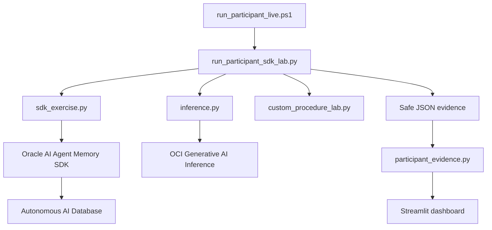

# Lab 1 — Código anotado: Oracle AI Agent Memory, ADB e inferencia

> Documento privado de facilitación. Es una lectura comentada de los fragmentos que componen la ejecución real. No sustituye los archivos fuente ni debe entregarse como archivo de configuración a participantes. No contiene credenciales, wallets, tokens ni identificadores reales.

## Cómo usar este documento

1. Muestra el archivo fuente enlazado.
2. Explica primero el objetivo de la función.
3. Usa la sección **Lectura técnica** para comentar cada bloque.
4. Ejecuta el modo correspondiente solo después de explicar qué llamadas realizará.

## Mapa de responsabilidades



---

# 1. PowerShell launcher

Archivo fuente: [run_participant_live.ps1](../../labs/lab01_agent_memory/scripts/run_participant_live.ps1)

## 1.1 Parámetros y carga controlada de la sesión

```powershell
[CmdletBinding()]
param(
    [Parameter(Mandatory)]
    [string]$TeamCode,
    [Parameter(Mandatory)]
    [string]$ParticipantCode,
    [string]$SessionFile,
    [switch]$Preflight,
    [ValidateSet("payment-idempotency", "contract-compatibility")]
    [string]$MemoryExercise,
    [switch]$ContextExperiment,
    [string]$CustomProcedure
)

$ErrorActionPreference = "Stop"

if ($SessionFile) {
    $resolvedSessionFile = Resolve-Path -LiteralPath $SessionFile -ErrorAction Stop
    . $resolvedSessionFile
}
```

### Lectura técnica

- `TeamCode` y `ParticipantCode` son obligatorios porque determinan el scope lógico de memoria y la ruta de evidencia.
- `SessionFile` es un archivo privado de configuración local; contiene rutas y parámetros no secretos asignados a la persona. No debe estar en GitHub.
- `ValidateSet` impide que se solicite un procedimiento no aprobado para el ejercicio base.
- `$ErrorActionPreference = "Stop"` convierte errores no terminantes de PowerShell en fallos explícitos. Esto evita continuar con un wallet, ruta o variable inválida.
- El punto (`.`) carga variables en el proceso actual de PowerShell. No copia contraseñas ni imprime valores sensibles.

## 1.2 Validación antes de ejecutar Python

```powershell
$repositoryRoot = (Resolve-Path (Join-Path $PSScriptRoot "..\..\..")).Path
$python = Join-Path $repositoryRoot ".venv\Scripts\python.exe"
$runner = Join-Path $PSScriptRoot "run_participant_sdk_lab.py"
$bundle = Join-Path $repositoryRoot "labs\lab01_agent_memory\exercises\team_payments_memory.json"

if (-not (Test-Path -LiteralPath $python -PathType Leaf)) {
    throw "Project virtual environment was not found: $python"
}
if (-not (Test-Path -LiteralPath $runner -PathType Leaf)) {
    throw "Participant runner was not found: $runner"
}
if (-not (Test-Path -LiteralPath $bundle -PathType Leaf)) {
    throw "Synthetic team bundle was not found: $bundle"
}
```

### Lectura técnica

El launcher no asume que el ambiente está listo. Verifica el Python del entorno virtual, el runner y el bundle sintético antes de hacer una conexión OCI o ADB. Esto distingue un problema local de instalación de un problema de permisos cloud.

## 1.3 Validación de la configuración de memoria

```powershell
$walletDirectory = Require-EnvironmentValue "LAB01_WALLET_DIR"
$null = Require-EnvironmentValue "LAB01_DB_USER"
$null = Require-EnvironmentValue "LAB01_DB_DSN"
$null = Require-EnvironmentValue "LAB01_MEMORY_SCHEMA_OWNER"
$null = Require-EnvironmentValue "LAB01_MEMORY_STORE_ID"

if (-not (Test-Path -LiteralPath $walletDirectory -PathType Container)) {
    throw "Wallet directory was not found: $walletDirectory"
}

Write-Host "LAB01_LAUNCHER_READY"
Write-Host "LAB01_WALLET_READY True"
Write-Host "LAB01_MEMORY_CONFIGURATION_READY True"
```

### Lectura técnica

- El script prueba que existan los nombres de variables requeridas, pero nunca muestra sus contenidos.
- Valida únicamente que el directorio del wallet exista. La contraseña del wallet se solicita después y de forma oculta en Python.
- Los marcadores `LAB01_*` son un contrato pedagógico: permiten saber exactamente qué frontera superó el participante.

## 1.4 Selección de una sola modalidad

```powershell
$selectedModes = [int]$Preflight.IsPresent + `
    [int](-not [string]::IsNullOrWhiteSpace($MemoryExercise)) + `
    [int]$ContextExperiment.IsPresent + `
    [int](-not [string]::IsNullOrWhiteSpace($CustomProcedure))
if ($selectedModes -gt 1) {
    throw "Choose exactly one of -Preflight, -MemoryExercise, -ContextExperiment, or -CustomProcedure."
}
```

### Lectura técnica

Una ejecución tiene una semántica verificable: preflight, memoria sin inferencia, procedimiento propio, experimento de contexto o comparación final. Mezclarlas haría imposible afirmar cuántas llamadas al modelo se hicieron o qué evidencia representa el JSON.

## 1.5 Ejemplo de bifurcación: preflight

```powershell
if ($Preflight) {
    Write-Host "LAB01_PREFLIGHT_NO_INFERENCE"
    & $python @runnerArguments --preflight
    exit $LASTEXITCODE
}
```

### Lectura técnica

El preflight delega en Python la validación completa, pero declara desde PowerShell que no habrá inferencia. Si el runner termina con error, el launcher conserva su código de salida.

## 1.6 Ejemplo de bifurcación: corrida final

```powershell
$evidencePath = Join-Path $repositoryRoot "artifacts\lab01\$safeTeamCode\$safeParticipantCode\oci-inference-evidence.json"

Write-Host "LAB01_LIVE_RUN_AUTHORIZED"
Write-Host "This run makes exactly two on-demand OCI Generative AI requests with synthetic data."
& $python @runnerArguments `
    "--output-path" $evidencePath `
    "--confirm-live-inference"

exit $LASTEXITCODE
```

### Lectura técnica

- La evidencia queda separada por equipo y participante.
- La corrida final exige una confirmación explícita porque realiza dos solicitudes on-demand.
- El launcher no construye prompts ni llama al modelo directamente. Es un guardrail y un orquestador.

---

# 2. Runner Python y construcción del runtime

Archivo fuente: [run_participant_sdk_lab.py](../../labs/lab01_agent_memory/scripts/run_participant_sdk_lab.py)

## 2.1 Adaptador hacia Oracle AI Agent Memory

```python
class OracleSdkAdapter(AgentMemoryAdapter):
    def __init__(self, memory: OracleAgentMemory) -> None:
        self._memory = memory

    def list_memories(self, *, user_id: str, limit: int) -> Sequence[Any]:
        return self._memory.list_memories(user_id=user_id, limit=limit)

    def add_memory(self, content: str, *, memory_type: str, user_id: str,
                   agent_id: str, metadata: dict[str, str]) -> Any:
        return self._memory.add_memory(
            content,
            memory_type=memory_type,
            user_id=user_id,
            agent_id=agent_id,
            metadata=metadata,
        )

    def search(self, query: str, *, user_id: str,
               record_types: list[str]) -> Sequence[Any]:
        return self._memory.search(
            query,
            user_id=user_id,
            exact_user_match=True,
            record_types=record_types,
            max_results=10,
        )
```

### Lectura técnica

El adaptador evita que la lógica didáctica dependa directamente de la implementación del SDK. Las tres operaciones del laboratorio son:

| Operación | Propósito |
| --- | --- |
| `list_memories()` | Comprueba persistencia e idempotencia. |
| `add_memory()` | Escribe una regla procedural explícita. |
| `search()` | Recupera reglas pertinentes dentro de un scope exacto. |

La llamada a `search()` es el punto central del algoritmo de recuperación. `exact_user_match=True` obliga coincidencia exacta del scope solicitado. `record_types=["guideline"]` evita que una futura memoria de tipo mensaje o perfil se confunda con una regla procedural. `max_results=10` protege el laboratorio contra contexto no acotado.

## 2.2 Pool ADB y configuración explícita del store

```python
def create_runtime_memory() -> tuple[OracleSdkAdapter, Any]:
    wallet_dir = required_environment("LAB01_WALLET_DIR")
    schema_owner = required_environment("LAB01_MEMORY_SCHEMA_OWNER")
    memory_store_id = required_environment("LAB01_MEMORY_STORE_ID")
    if schema_owner.casefold() == memory_store_id.casefold():
        raise RuntimeError("LAB01_MEMORY_SCHEMA_OWNER must be the memory owner schema")

    password = getpass("Application database password: ")
    wallet_password = getpass("Wallet password: ")
    pool = oracledb.create_pool(
        user=required_environment("LAB01_DB_USER"),
        password=password,
        dsn=required_environment("LAB01_DB_DSN"),
        config_dir=wallet_dir,
        wallet_location=wallet_dir,
        wallet_password=wallet_password,
        min=1,
        max=1,
        increment=1,
    )
    memory = OracleAgentMemory(
        connection=pool,
        schema_policy=SchemaPolicy.REQUIRE_EXISTING,
        schema_owner=schema_owner,
        memory_store_id=memory_store_id,
        search_strategy=SearchStrategy.KEYWORD,
        memory_extraction_config=MemoryExtractionConfig(extract_memories=False),
    )
    return OracleSdkAdapter(memory), pool
```

### Lectura técnica

1. `getpass()` recibe ambas contraseñas solamente en memoria del proceso; no se guardan en el archivo de sesión ni en el JSON de evidencia.
2. `oracledb.create_pool()` abre un pool mTLS. Para el workshop se limita a una conexión (`min=1`, `max=1`), suficiente para una ejecución individual y fácil de observar.
3. `REQUIRE_EXISTING` protege el store compartido. Solo la persona owner lo inicializa una vez durante prework con una política de creación autorizada.
4. `KEYWORD` hace explícita una recuperación léxica. Lab 1 no utiliza embeddings, vectores ni reranking semántico.
5. `extract_memories=False` impide que el SDK extraiga o infiera nuevas memorias automáticamente desde texto conversacional. Toda escritura es explícita y auditada por el código.

## 2.3 Perfil OCI y signer de token de sesión

```python
def load_oci_profile() -> tuple[dict[str, str], Any | None]:
    config_file = os.getenv("OCI_CONFIG_FILE")
    profile = os.getenv("OCI_CONFIG_PROFILE", "DEFAULT")
    if not config_file:
        return oci.config.from_file(profile_name=profile), None

    try:
        config = oci.config.from_file(file_location=config_file, profile_name=profile)
    except oci.exceptions.InvalidConfig:
        config = load_session_token_config(config_file, profile)

    if "security_token_file" not in config:
        return config, None

    token = Path(config["security_token_file"]).read_text(encoding="utf-8").strip()
    private_key = oci.signer.load_private_key_from_file(config["key_file"])
    signer = oci.auth.signers.SecurityTokenSigner(token, private_key)
    return config, signer
```

### Lectura técnica

Esta función permite que el participante use su propia sesión OCI local. Si el perfil contiene un `security_token_file`, el código construye un `SecurityTokenSigner`; así las llamadas OCI se realizan como la identidad activada del participante, nunca como la facilitadora.

## 2.4 Validación de tenancy y de acceso al modelo

```python
def validate_tenancy_binding() -> None:
    expected_tenancy = required_environment("LAB01_TENANCY_ID")
    config, _ = load_oci_profile()
    configured_tenancy = config.get("tenancy")
    if configured_tenancy != expected_tenancy:
        raise RuntimeError("The OCI session profile belongs to a different tenancy")
    print("LAB01_OCI_TENANCY_MATCH True")

def validate_model_access() -> None:
    config, signer = load_oci_profile()
    settings = inference_settings()
    client = oci.generative_ai.GenerativeAiClient(config, signer=signer)
    response = client.list_models(compartment_id=settings.compartment_id, limit=1000)
    if not any(model.id == settings.model_id for model in response.data.items):
        raise RuntimeError("The configured LAB01_CHAT_MODEL_ID is not discoverable")
```

### Lectura técnica

- `validate_tenancy_binding()` evita que un navegador con una sesión antigua de otro tenant continúe accidentalmente.
- `validate_model_access()` consulta el catálogo de modelos. No envía prompt, no genera texto y no consume una inferencia.
- Un `401`, `403` o `404` se traduce a una instrucción operativa: revisar tenant, identidad, grupo IAM, política y región antes de ejecutar la corrida.

---

# 3. Preflight

## Código relevante

```python
def run_preflight(*, team_code: str, participant_code: str) -> None:
    print("LAB01_PREFLIGHT_START")
    validate_tenancy_binding()
    memory, pool = create_runtime_memory()
    try:
        scopes = build_team_scopes(team_code, participant_code)
        memory.list_memories(user_id=scopes.individual, limit=1)
    finally:
        pool.close()
    validate_model_access()
    print("LAB01_PREFLIGHT_DATABASE_ACCESS True")
    print("LAB01_PREFLIGHT_MEMORY_STORE_ACCESS True")
    print("LAB01_PREFLIGHT_MODEL_ACCESS True")
    print("LAB01_PREFLIGHT_INFERENCE_CLIENT_READY True")
    print("LAB01_PREFLIGHT_COMPLETE")
```

### Lectura técnica

El preflight comprueba cinco fronteras sin crear memoria y sin invocar el modelo:

1. Perfil OCI en el tenancy correcto.
2. Contraseña del usuario temporal ADB y wallet válidos.
3. Conexión mTLS a Autonomous Database.
4. Lectura autorizada del memory store ya existente.
5. Descubrimiento autorizado del modelo configurado y construcción del cliente de inferencia.

La llamada `list_memories(..., limit=1)` es una lectura mínima: demuestra acceso al store, pero no persiste contenido.

---

# 4. Scopes, idempotencia y persistencia

Archivo fuente: [sdk_exercise.py](../../labs/lab01_agent_memory/src/lab01_agent_memory/sdk_exercise.py)

## 4.1 Construcción de scopes

```python
def build_team_scopes(team_code: str, participant_code: str) -> TeamScopes:
    team = team_code.strip().lower()
    participant = participant_code.strip().lower()
    return TeamScopes(
        individual=f"{team}:{participant}",
        shared=f"{team}:shared",
        control=f"{team}:control",
    )
```

### Lectura técnica

La normalización a minúsculas hace que `T01/P02` y `t01/p02` produzcan el mismo scope. El laboratorio utiliza:

```text
individual = t01:p02
shared     = t01:shared
control    = t01:control
```

El scope individual se usa en las operaciones del participante. El scope control contiene datos sintéticos colocados deliberadamente fuera de su alcance, para probar que no se recuperan.

## 4.2 Detección de memoria existente

```python
def _memory_exists(memory: AgentMemoryAdapter, scope: str, content: str) -> bool:
    records = memory.list_memories(user_id=scope, limit=100)
    return any(_record_content(record) == content for record in records)
```

### Lectura técnica

Esta es la idempotencia del workshop. Antes de escribir, compara el contenido de la regla contra las memorias durables del mismo scope. Si ya existe, no inserta un duplicado.

Es importante explicar su límite: es una protección pedagógica a nivel de aplicación; no es un mecanismo transaccional de deduplicación para miles de procesos concurrentes.

## 4.3 Escritura explícita de una regla

```python
memory.add_memory(
    procedure.content,
    memory_type="guideline",
    user_id=scope,
    agent_id=AGENT_ID,
    metadata={
        "team_code": team_code,
        "participant_code": participant_code,
        "procedure_id": procedure.identifier,
        "synthetic": "true",
        "lab": "lab01",
    },
)
```

### Lectura técnica

- `procedure.content`: regla procedural que se almacenará.
- `memory_type="guideline"`: clasifica el registro como una guía o decisión procedural.
- `user_id=scope`: define el alcance lógico de escritura y lectura.
- `agent_id`: atribuye la memoria al agente didáctico del laboratorio.
- `metadata`: permite trazabilidad y gobierno sin mezclar esos atributos con el texto principal.

## 4.4 Recuperación y control negativo

```python
individual_results = list(
    memory.search(
        bundle.retrieval_query,
        user_id=scopes.individual,
        record_types=["guideline"],
    )
)

cross_scope_results = list(
    memory.search(
        bundle.cross_team_challenge,
        user_id=scopes.individual,
        record_types=["guideline"],
    )
)

isolation_passed = not cross_scope_results
```

### Lectura técnica

La primera búsqueda debe traer la regla que responde a la consulta. La segunda usa una frase asociada al control, pero la ejecuta contra el scope individual. Un resultado vacío da `isolation_passed=True`.

Esto prueba el comportamiento de recuperación configurado. No equivale por sí solo a seguridad por fila ni reemplaza los grants ADB, IAM o los controles de red.

---

# 5. Comparación real de inferencias

Archivo fuente: [inference.py](../../labs/lab01_agent_memory/src/lab01_agent_memory/inference.py)

## 5.1 Construcción uniforme del prompt

```python
def build_prompt(question: str, decisions: list[tuple[str, str]]) -> str:
    if not decisions:
        raise ValueError("At least one decision is required for model inference")
    context = "\n".join(
        f"- [{identifier}] {content}" for identifier, content in decisions
    )
    return f"Decision rules:\n{context}\n\nQuestion: {question}"
```

### Lectura técnica

La estructura del prompt permanece constante. Solo cambia `decisions`, es decir, el bloque de contexto. Esta decisión de diseño hace válido el experimento: no se comparan dos prompts arbitrariamente diferentes, sino dos estrategias de contexto para la misma pregunta.

## 5.2 Medición de una variante

```python
def _run_variant(client, prompt, settings, required_terms) -> InferenceVariant:
    started = perf_counter()
    response = client.chat(prompt, settings)
    latency_ms = round((perf_counter() - started) * 1000)

    quality_passed, finish_reason = _validate_response(response, required_terms)
    prompt_tokens = _required_usage(response.prompt_tokens, "prompt_tokens")
    completion_tokens = _required_usage(response.completion_tokens, "completion_tokens")
    total_tokens = _required_usage(response.total_tokens, "total_tokens")

    if total_tokens != prompt_tokens + completion_tokens:
        raise RuntimeError("OCI Inference returned inconsistent token usage")
```

### Lectura técnica

La telemetría no se estima localmente. Proviene de la respuesta real de OCI Generative AI. El código comprueba que los tres valores sean consistentes antes de aceptar la evidencia.

## 5.3 Baseline frente a memoria recuperada

```python
baseline = _run_variant(
    client,
    build_prompt(question, baseline_decisions),
    settings,
    required_terms,
)
memory_optimized = _run_variant(
    client,
    build_prompt(question, retrieved_decisions),
    settings,
    required_terms,
)

if not baseline.quality_passed or not memory_optimized.quality_passed:
    raise RuntimeError("A model response did not satisfy the required decision criteria")
if memory_optimized.prompt_tokens >= baseline.prompt_tokens:
    raise RuntimeError("Retrieved memory did not reduce OCI prompt tokens")
```

### Lectura técnica

La comparación final realiza exactamente dos llamadas reales. Ambas deben superar el criterio de calidad. El laboratorio falla deliberadamente si la variante con memoria no reduce tokens de entrada; así no presenta una optimización inexistente como éxito.

La conclusión correcta es: *en esta ejecución controlada se redujeron tokens de entrada manteniendo el criterio de calidad*. No significa que toda memoria siempre reduzca costos en producción.

---

# 6. Procedimiento diseñado por el participante

Archivo fuente: [custom_procedure_lab.py](../../labs/lab01_agent_memory/src/lab01_agent_memory/custom_procedure_lab.py)

## Código relevante

```python
target_query = " ".join(procedure.trigger_terms[:2])
cases = (
    ("targeted", target_query),
    ("broad", procedure.trigger_terms[0]),
    ("negative_control", "database migration controlled phases"),
)

for label, query in cases:
    results = list(
        memory.search(query, user_id=scopes.individual, record_types=["guideline"])
    )
    contents = [_content(record) for record in results]
    study.append(
        {
            "label": label,
            "query": query,
            "result_count": len(results),
            "custom_procedure_retrieved": procedure_content in contents,
        }
    )
```

### Lectura técnica

Se evalúa una regla sintética propia con tres señales distintas:

| Caso | Propósito |
| --- | --- |
| `targeted` | Comprueba que términos específicos recuperen la regla. |
| `broad` | Muestra cómo una consulta amplia puede reducir precisión. |
| `negative_control` | Comprueba que un tema no relacionado no recupere la regla. |

No se crea un cliente de inferencia en esta actividad; el objetivo es evaluar recuperación, no generación.

---

# 7. Validación de evidencia antes del dashboard

Archivo fuente: [participant_evidence.py](../../labs/lab01_agent_memory/src/lab01_agent_memory/participant_evidence.py)

## Código relevante

```python
if payload.get("evidence_type") not in _EVIDENCE_TYPES:
    raise ValueError("The JSON is not approved Lab 1 participant evidence")
if payload.get("contains_no_secrets") is not True:
    raise ValueError("The evidence must explicitly declare contains_no_secrets=true")
if payload.get("isolation_passed") is not True:
    raise ValueError("The evidence does not show an approved isolation result")
```

### Lectura técnica

El dashboard no acepta un JSON arbitrario. Antes de visualizarlo, el parser exige:

- Tipo de evidencia conocido.
- Declaración explícita de ausencia de secretos.
- Aislamiento aprobado.
- Esquema `REQUIRE_EXISTING` y estrategia `KEYWORD` para evidencia del SDK.
- Persistencia confirmada.
- Telemetría OCI consistente cuando la corrida incluyó inferencia.

Esto crea una frontera de confianza entre un archivo cargado por un usuario y las métricas que el dashboard presentará como evidencia real.

---

# 8. Dashboard: evidencia real frente a simulación docente

Archivo fuente: [app.py](../../labs/lab01_agent_memory/ui/app.py)

El dashboard no ejecuta el laboratorio ni se conecta directamente a ADB durante la visualización. Tiene dos responsabilidades deliberadamente separadas:

1. Interpretar JSON seguro que ya produjo el runner del participante.
2. Ofrecer una simulación didáctica local para explicar el algoritmo sin crear datos ni consumir OCI.

## 8.1 Carga de evidencia real

```python
uploaded = st.file_uploader(
    "Cargar JSON seguro ya generado",
    type="json",
    key="participant_evidence_upload",
)

if uploaded is None and local_paths:
    selected_path = st.selectbox(
        "Evidencia real detectada en artifacts",
        options=local_paths,
        format_func=_evidence_path_label,
    )

evidence = load_participant_evidence(raw_json)
```

### Lectura técnica

Hay dos formas de entregar evidencia al dashboard:

- **Seleccionar un artefacto local** ya creado bajo `artifacts/` por el runner.
- **Cargar manualmente** un JSON seguro generado en otra máquina.

En ambos casos el dashboard pasa el contenido por `load_participant_evidence()`. No toma como verdad cualquier archivo con extensión `.json`. El parser aplica las validaciones de la sección anterior antes de renderizar métricas, alcance, procedimientos recuperados o telemetría.

Por eso los números de la pestaña **Mi evidencia real** permanecen estables cuando se cambia una pregunta en el simulador: provienen del JSON de una corrida anterior, no de controles visuales de la página.

## 8.2 Simulador docente local

```python
def render_local_simulator() -> None:
    """Render a deliberately local teaching simulator, separate from OCI evidence."""

    st.info(
        "No consulta ADB, OCI Generative AI ni el SDK. "
        "Sus botones solo cambian la vista local del algoritmo."
    )

    if st.button("Mostrar recuperación simulada"):
        st.session_state["lab01_show_memory"] = True

    if st.button("Reiniciar demostración"):
        st.session_state["lab01_show_memory"] = False
        st.session_state["lab01_show_economy"] = False

    report = build_report(team_id, question)
```

### Lectura técnica

`build_report(team_id, question)` trabaja con decisiones sintéticas incluidas en el código de la interfaz. No crea un pool `oracledb`, no instancia `OracleAgentMemory`, no llama a OCI SDK y no emite JSON de evidencia.

| Control visual | Qué cambia | Qué no cambia |
|---|---|---|
| Equipo o pregunta | Datos y explicación sintética mostrados en pantalla. | ADB, OCI, memoria persistida, tokens y artefactos. |
| **Mostrar recuperación simulada** | Expone visualmente el subconjunto que una recuperación dirigida devolvería. | No ejecuta búsqueda real ni registra datos. |
| **Reiniciar demostración** | Limpia el estado de la vista en `st.session_state`. | No borra memorias, tablas, archivos ni sesiones. |

El objetivo pedagógico es permitir que la facilitadora explique primero la diferencia entre *contexto completo* y *contexto recuperado* sin volver a ejecutar el flujo real. Es una maqueta reproducible del algoritmo, no una consola operativa.

## 8.3 Pestañas del dashboard

```python
tabs = st.tabs(
    [
        "1. Mi evidencia real",
        "2. Simulador docente",
        "3. Código y SDK",
        "4. Modelo de tablas",
        "5. Experimentos reales",
        "6. Diseño y evaluación",
    ]
)
```

La interfaz organiza la conversación del workshop, no el orden obligatorio de ejecución:

| Pestaña | Fuente de la información | Uso didáctico |
|---|---|---|
| **Mi evidencia real** | JSON seguro de los runners. | Demostrar lo que efectivamente ocurrió. |
| **Simulador docente** | Datos sintéticos y estado local de Streamlit. | Explicar recuperación sin afectar OCI. |
| **Código y SDK** | Fragmentos estáticos del repositorio. | Conectar conceptos con implementación. |
| **Modelo de tablas** | Modelo lógico documentado. | Explicar dónde persiste Agent Memory. |
| **Experimentos reales** | JSON de la comparación controlada. | Analizar calidad, tokens y variantes. |
| **Diseño y evaluación** | Evidencia de procedimiento propio. | Discutir gobernanza y precisión de recuperación. |

---

# 9. Qué no debes afirmar al explicar el código

- No afirmar que Lab 1 utiliza vector search: usa `KEYWORD`.
- No afirmar que el SDK aprende automáticamente: `extract_memories=False`.
- No afirmar que el scope es seguridad por fila: es un límite lógico de recuperación.
- No afirmar que cada participante crea las ocho tablas: el store compartido ya existe.
- No afirmar que la reducción de tokens es una garantía universal de ahorro: es una medición de un experimento controlado.
- No afirmar que el dashboard ejecuta el agente: interpreta evidencia generada previamente.

## Lectura final recomendada

Para presentar código en vivo, sigue este orden:

1. Launcher PowerShell.
2. `create_runtime_memory()`.
3. `OracleSdkAdapter.search()`.
4. `run_memory_exercise()` o `run_sdk_exercise()`.
5. `run_token_comparison()`.
6. `participant_evidence.py`.
7. `ui/app.py`, diferenciando evidencia real y simulación local.

Ese orden permite que el público conecte el comando, la seguridad, la memoria, la recuperación, la inferencia y la evidencia en una sola narrativa.
