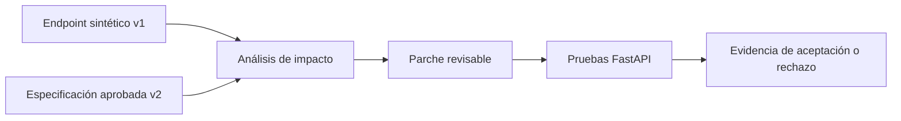

# Laboratorio 3 Cambio seguro de API

## 0 Objetivo y tiempo estimado

**Objetivo:** transformar un cambio pequeño de contrato API en un análisis de impacto, un parche acotado y pruebas de regresión verificables.

**Tiempo estimado:** 140 minutos de actividad principal y hasta 40 minutos para instalación, preguntas y contingencia.

**Mensaje para Khipu:** OCI convierte contexto técnico en cambios más seguros y testeables.

## 1 Resultado esperado

El equipo identifica tres impactos del cambio v1 a v2, revisa un parche FastAPI y prueba que una solicitud v2 válida se acepta mientras que el contrato heredado se rechaza.

## 2 Prerrequisitos

- [Guía de prework](README.md) completada.
- Python 3.11.9 y dependencias instaladas.
- No se requiere ADB, wallet ni modificación de recursos OCI.
- Si se utiliza un modelo OCI Generative AI para analizar el cambio, se usa únicamente el código y contrato sintéticos del repositorio.

## 3 Flujo objetivo



## 4 Construcción paso a paso

### 4.1 Entender el cambio de contrato

**Para qué se usa:** identificar qué clientes se romperían antes de escribir código.

**Qué hacer:** abre:

- `labs/lab03_api_change/exercise/payment_api_v1.py`
- `labs/lab03_api_change/data/payment_api_v2.md`

**Qué deberías ver:** v2 elimina `paymentStatus`, exige `idempotencyKey`, rechaza campos desconocidos y retorna HTTP `202` con estado `ACCEPTED`.

**Error común:** tratar el cambio como una modificación cosmética. La eliminación de un campo y la inclusión de un campo requerido son cambios incompatibles.

### 4.2 Ejecutar el análisis determinista

**Para qué se usa:** producir una línea base que no dependa de la variabilidad de un modelo.

**Qué hacer:** ejecuta:

```powershell
python -m lab03_api_change.demo --output-dir artifacts/lab03/team-01
```

**Qué deberías ver:**

```text
ANALYSIS_CHANGE_COUNT 3
REQUIRED_IMPACTS_PRESENT True
PATCH_REVIEW_REQUIRED True
REGRESSION_TESTS_REQUIRED True
```

**Error común:** aceptar un parche antes de comprobar que el análisis cubre los tres impactos aprobados: `PAY-001`, `PAY-002` y `PAY-003`.

### 4.3 Usar OCI Generative AI como asistente opcional

**Para qué se usa:** contrastar un borrador de análisis generado por IA con la línea base determinista.

**Qué hacer:** utiliza el texto de `labs/lab03_api_change/prompts/change-analysis.md` junto con el endpoint sintético v1 y la especificación v2.

**Qué deberías ver:** un informe con cambios incompatibles, archivos a modificar, plan de parche, pruebas positivas y negativas, y preguntas para revisión humana.

**Error común:** pegar código de Khipu, secretos o información de producción en el prompt. El modelo no puede aprobar su propio resultado, hacer commits, desplegar ni ejecutar llamadas de pago.

### 4.4 Revisar el parche

**Para qué se usa:** limitar el cambio a lo que el contrato v2 exige.

**Qué hacer:** revisa `labs/lab03_api_change/patches/payment_api_v2.patch` y la implementación de referencia en `labs/lab03_api_change/src/lab03_api_change/app.py`.

**Qué deberías ver:** el endpoint acepta `amount`, `currency` e `idempotencyKey`; rechaza `paymentStatus`; y produce una respuesta v2 determinista.

**Error común:** ampliar el parche para modificar infraestructura, identidad, persistencia o despliegue. Este laboratorio evalúa un solo endpoint sintético.

### 4.5 Ejecutar las pruebas de regresión

**Para qué se usa:** convertir el contrato aprobado en una verificación ejecutable.

**Qué hacer:** ejecuta:

```powershell
python -m pytest labs/lab03_api_change/tests
```

**Qué deberías ver:** cinco pruebas correctas:

- Una solicitud v2 válida devuelve `202` y `ACCEPTED`.
- Falta `idempotencyKey` produce un error de validación.
- El campo heredado `paymentStatus` produce un error de validación.
- Los impactos del análisis son completos y serializables.

**Error común:** usar una prueba positiva como única evidencia. Un cambio seguro también demuestra que los contratos heredados fallan de manera controlada.

## 5 Puerta de evidencia

- [ ] El informe contiene `PAY-001`, `PAY-002` y `PAY-003`.
- [ ] El parche fue revisado por una persona antes de aceptarse.
- [ ] Una solicitud v2 válida devuelve `202`, `ACCEPTED`, `payment_id` y `api_version` v2.
- [ ] Las solicitudes inválidas y heredadas se rechazan.
- [ ] Las pruebas de regresión terminan correctamente.
- [ ] Solo se utilizaron archivos sintéticos.

## 6 Cierre

Conserva el informe bajo `artifacts/lab03/<team-id>/`. El resultado demuestra un flujo de ingeniería asistida, no un sistema autónomo de cambios o despliegues.
