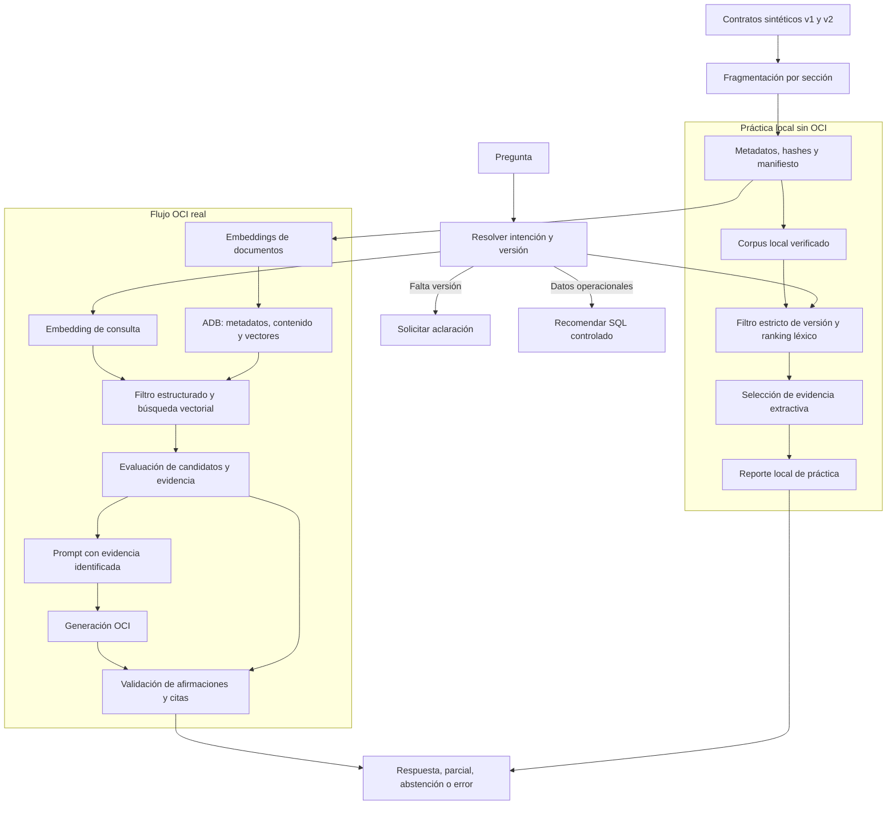

# Arquitectura y contrato de evidencia

El laboratorio tiene dos rutas deliberadamente distintas:

- **Práctica local obligatoria:** inspecciona el corpus y aplica recuperación léxica determinista. Sirve para observar fragmentación, metadatos, filtro y ranking sin coste ni llamadas a OCI.
- **Flujo OCI obligatorio:** usa embedding, Autonomous Database (ADB), AI Vector Search y generación OCI reales. Es la única ruta que acredita la validación cloud y publica una respuesta del modelo.

La ruta local no es un fallback de la ruta OCI. Si OCI falla, se registra como falla operacional y el segmento cloud queda pendiente.



## Fragmentos y metadatos

El corpus base tiene nueve secciones Markdown completas: cuatro de v1 y cinco de v2. No se usa solapamiento ni truncamiento. `ContractChunk` es el contrato compartido entre ambas rutas e incluye, entre otros, identidad documental, `corpus_id`, API, versión, sección, líneas, clasificación, hashes y procedencia de embedding.

El manifiesto valida los documentos en LF normalizado. Un hash comprueba integridad frente a una fuente conocida; no certifica que el documento sea correcto ni que responda una pregunta.

## Recuperación y aislamiento de versiones

Los filtros obligatorios son: `corpus_id` activo, `api_name`, `contract_version` y clasificación `synthetic`. Se aplican antes del ranking lógico.

- La práctica local expone `token_overlap`: mayor valor significa más coincidencia léxica.
- La búsqueda OCI expone `cosine_distance`: menor valor significa mayor proximidad vectorial.

Ninguna métrica demuestra por sí misma que un extracto responde la pregunta. La aplicación selecciona evidencia por sección/faceta y luego verifica la procedencia antes de publicar una afirmación.

Las comparaciones recuperan v1 y v2 por separado. Una migración hacia v2 usa inicialmente el alcance v2 y su sección **Migración desde v1**. Los resultados de una versión no completan silenciosamente la otra.

## Generación, evidencia y resultado visible

El dashboard presenta una referencia independiente del ejercicio junto a la respuesta observada. La referencia no se envía al modelo. Para cada afirmación publicada, el participante puede llegar a:

```text
afirmación → ID de evidencia → extracto → sección → versión → líneas → hash
```

La aplicación crea las citas; el modelo solo puede elegir IDs de evidencia suministrados. El validador admite en este MVP texto literal contenido en el extracto. Una cita válida todavía requiere revisión humana de relevancia y completitud.

Los estados distinguen `answered`, `partial`, `needs_clarification`, `insufficient_evidence`, `conflicting_evidence`, `structured_data_required` y `error`. Una lista de candidatos no vacía no equivale a evidencia suficiente.

## Seguridad y operación

Se usa un tenant y ADB compartidos en Chicago, con identidad, schema, tabla vectorial, sesión y namespace de artefactos individuales. La validación de sesión comprueba `SESSION_USER` y `CURRENT_SCHEMA`, y rechaza privilegios transversales y roles administrativos.

Las llamadas OCI son opt-in: el dashboard solicita confirmación independiente para inferencia y carga. Los reintentos no son automáticos. Los reportes conservan estados, etapas, duraciones, citas y telemetría segura; no guardan secretos ni vectores completos.

## Límites pedagógicos y técnicos

- Los contratos son sintéticos; no describen SLA, autenticación real, límites de producción ni hechos operacionales.
- T05 y T12 pueden resolverse mediante control de aplicación sin llamar al modelo.
- T10 y T11 prueban que candidatos cercanos no justifican una respuesta no documentada.
- SQL queda restringido a una extensión controlada: no hay SQL libre generado por el modelo ni resultados inventados.
- El corpus pequeño usa búsqueda exacta; no se requiere índice ANN para el objetivo del workshop.

Referencias: [Oracle AI Vector Search exacta](https://docs.oracle.com/en/database/oracle/oracle-database/26/vecse/perform-exact-similarity-search.html) y [OCI EmbedTextDetails](https://docs.oracle.com/en-us/iaas/tools/python/latest/api/generative_ai_inference/models/oci.generative_ai_inference.models.EmbedTextDetails.html).
