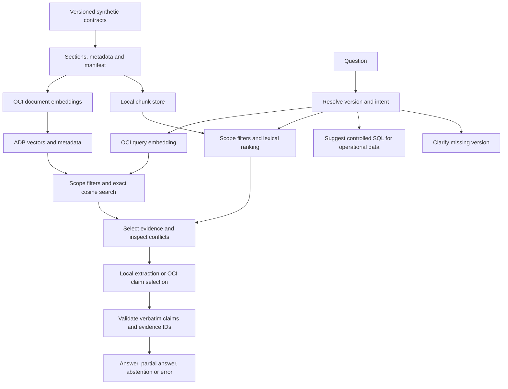

# Current workshop execution contract

The participant path is now a local Streamlit dashboard backed exclusively by actual OCI embedding/ADB retrieval/chat. The CLI shares execution.py. No lexical retriever or simulated fixture is used as a fallback. Individual participants use separate schemas in one shared Chicago tenant and ADB. Local-only routes in the original reference diagram below are retained solely as developer regression tools; they are not workshop execution.

# Architecture and evidence contract

## Participant deployment

One shared Chicago tenant and ADB; each participant owns a separate user/schema and table. OCI identities, database credentials, local sessions and report directories are individual. The connection factory validates server-side SESSION_USER/CURRENT_SCHEMA and rejects ANY privileges/DBA.

## Boundaries

The corpus consists of nine Markdown sections. Preserve whole sections with no overlap. The manifest checks byte hashes; chunk metadata uses normalized LF source text and line locations. Never truncate embeddings silently. Future oversized sections require reviewed subdivision.

`ContractChunk` in models.py is the shared contract. It includes document identity, corpus, source/title/type, API/version, section/subsection, content, source URI/lines, optional effective date, classification, hashes, embedding provenance and optional load timestamp. Local embedding fields are null. ADB stores the common object as validated JSON plus relational scope/provenance columns and VECTOR. Loading time is not effective date; a hash is not a truth certificate.

Strict filters: active corpus, API, requested version, synthetic classification, selected model and dimension. Participant isolation comes from schema permissions, not a user-selected participant filter. Query values are bound; only a validated table identifier and bounded integer row limit enter SQL syntax. No ADMIN account is accepted. The new participant bootstrap grants CREATE SESSION and CREATE TABLE with a 128M quota; index creation on owned tables requires no separate CREATE INDEX system privilege. Administrators must still rehearse it in the target tenant.

The relational filter defines eligible candidates before logical ranking; no assumption is made about physical optimizer order. Exact cosine search is explicit. No HNSW/IVF index is required. A calibrated maximum distance discards weak neighbors; topic/section evidence selection is a separate gate. The bounded recognizer supports endpoint, migration, idempotency, response and errors in English. Arbitrary questions need a broader relevance evaluator before production use.

Comparisons use two separately filtered retrievals. Migration toward v2 uses v2. Multiple inconsistent texts for the same version/section produce a conflict. The MVP does not detect arbitrary contradictions across unrelated sections: the rubric must cover that limitation.

## Generation, visible answers and expected criteria

The dashboard shows the actual published answer next to an independent reference, with claim/source expanders and operation traces. Reference answers are never sent to the model. Participant acceptance uses 16 non-fixture cases. Generation failures are displayed without substituting local answers. Local clarification/routing decisions are explicitly identified and never claimed as model responses.

## Generation and claims

The prompt treats documents and questions as untrusted data. The model returns JSON status and claims with evidence IDs. Only text literally present in every cited excerpt is admitted. The application creates citations, not the model. This avoids pretending that a metadata list proves a paraphrase. It also limits expressive synthesis; free-form summaries need independent entailment assessment.

Report 2.0: run ID, mode, status, requested versions, candidate list with score semantics, claims, citations, limitations, sufficient_evidence and timing. Lexical overlap is higher-is-better; cosine distance is lower-is-better. Nonanswer paths never acquire sufficient_evidence from a nonempty list. Unknown evidence IDs and malformed outputs are errors, not documentary abstentions. Unsupported questions, no candidates, conflicts and provider failures remain distinct.

## Security and operations

Use an approved child compartment, tags Environment/Project/Owner/CostCenter/CreatedBy, least privilege, private ADB connectivity and separate participant schemas. No new infrastructure is provisioned here. Separate ingestion privileges from runtime SELECT where the operating model permits. Store production secrets in Vault; protect local wallets outside source control. Do not log provider exception bodies, credentials or full vectors.

OCI calls are opt-in, with independent inference and load acknowledgements. Provider retries are disabled to bound paid calls; operators review failures before retrying. SDK timeout is 10 seconds connect/30 read; ADB call timeout is 5 seconds. The live runner records retrieval/generation timing, attempted chat calls, successful query embedding calls and provider usage when exposed. A failed request may be billable despite no successful response; call telemetry is not a billing invoice.

## Compatibility and validation

The new SQL schema is incompatible with the legacy table. Prepare a new approved table/schema and load the frozen corpus. No automatic DDL or destructive migration is supplied. Legacy attach_evidence remains a metadata attachment with support explicitly unverified. Its sufficient_evidence flag is no longer true for arbitrary text.

References: [Oracle exact vector search](https://docs.oracle.com/en/database/oracle/oracle-database/26/vecse/perform-exact-similarity-search.html), [OCI embedding API](https://docs.oracle.com/en-us/iaas/tools/python/latest/api/generative_ai_inference/models/oci.generative_ai_inference.models.EmbedTextDetails.html).
