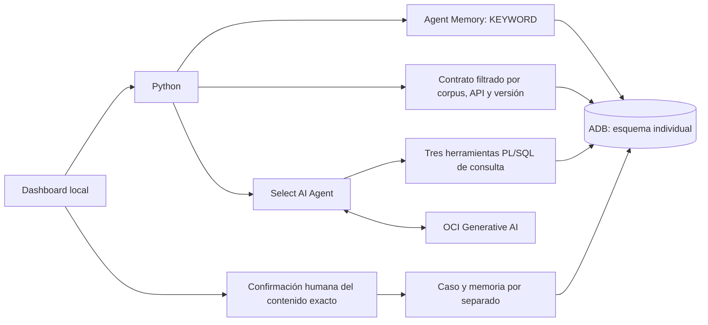

# Workshop 3: agente de pagos con memoria, evidencia y herramientas

**Empieza por la [guía única del participante](docs/participant_step_by_step.md).** Incluye instalación, descarga del paquete privado, autenticación, comandos de ejercicios, dashboard, revisión humana y recuperación de memoria desde una sesión nueva. El [cuaderno](docs/participant_workbook.md) sirve para registrar tus resultados.

Tres horas de actividades, con instalación y accesos completados previamente. Una ADB compartida mantiene esquemas, memoria y objetos separados por participante. Solo se usan pagos y contratos sintéticos.



Python recupera memoria y evidencia antes de invocar al agente. El modelo selecciona las herramientas de consulta; no puede registrar un caso, aprobar una memoria ni ejecutar un pago. La integración con Agent Memory es explícita y la extracción automática está deshabilitada.

## Qué contiene este laboratorio público

- Código de la integración, dashboard y validación de evidencia.
- Contratos sintéticos y ejercicios de herramienta y rol.
- Comandos del participante para respaldar, instalar y probar sus propios ejercicios.
- Pruebas locales y una prueba OCI opt-in, deshabilitada por defecto.
- Guía en español y cuaderno de trabajo.

La guía de facilitación, el aprovisionamiento del tenant, credenciales, wallets, roster, calibraciones y evidencias privadas no se distribuyen aquí. Recibe tu asignación individual por el canal privado; no configures recursos administrativos.

## Instalación rápida después de leer la guía

Desde la raíz del repositorio, con Python 3.11.9:

```powershell
python -m venv .venv
.\.venv\Scripts\Activate.ps1
python -m pip install --upgrade pip
python -m pip install -e ".[dev,lab03-agent]"
python -m pip check
python -m pytest labs/lab03_payment_agent/tests -q
python -m streamlit run labs/lab03_payment_agent/ui/app.py --server.address 127.0.0.1 --server.port 8503 --server.fileWatcherType none
```

Abre `http://127.0.0.1:8503`. Las contraseñas se solicitan localmente. No almacenes secretos en `.env`, código o sesión. Cada investigación exige aprobación de consumo; un timeout local no garantiza cancelación del lado del servidor.

## Estado y límites

Un piloto con servicios reales completó las tres herramientas; su respuesta almacenada fue revalidada y un caso y una memoria aprobados se guardaron sin duplicados. La memoria se recuperó desde una sesión nueva. Eso no acredita por sí solo una nueva ejecución desde este dashboard, los negativos del agente, el aislamiento entre dos identidades ni 15 sesiones concurrentes. La prueba end to end del participante se realiza después de la publicación, con su asignación preparada y consumo autorizado.

Las pruebas locales no generan respuestas OCI ni se presentan como evidencia de ejecución en la nube. Los tokens no disponibles permanecen como null. Conserva tus reportes fuera de GitHub y deja pendiente cualquier prueba que no hayas ejecutado.

El [laboratorio anterior de cambios de API](../lab03_api_change/README.md) se conserva como material complementario; no es el recorrido de este Workshop 3.
