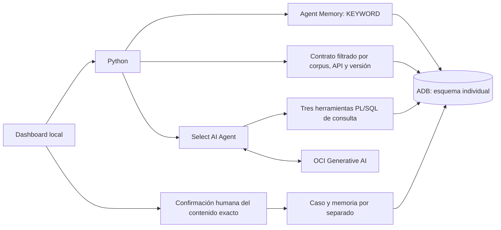

# Workshop 3: agente de pagos con memoria, evidencia y herramientas

**Empieza por la [guía única del participante](docs/participant_step_by_step.md).** Incluye instalación, descarga del paquete privado, autenticación, comandos de ejercicios, dashboard, revisión humana y recuperación de memoria desde una sesión nueva. El [cuaderno](docs/participant_workbook.md) sirve para registrar tus resultados.

Tres horas de actividades, con instalación y accesos completados previamente. Una ADB compartida mantiene esquemas, memoria y objetos separados por participante. Solo se usan pagos y contratos sintéticos.



Python recupera memoria y evidencia antes de invocar al agente. El modelo selecciona las herramientas de consulta; no puede registrar un caso, aprobar una memoria ni ejecutar un pago. La integración con Agent Memory es explícita y la extracción automática está deshabilitada.

## Qué aprenderás a construir

El dashboard tiene cinco áreas: **Construir mi agente → Consultar → Evidencia RAG → Memoria → Evaluar**. El participante define objetivo e instrucciones y registra tres herramientas, un agente, una tarea y un equipo mediante `DBMS_CLOUD_AI_AGENT`. Después hace preguntas libres en español dentro del caso de idempotencia; puede inspeccionar SQL observado, candidatos RAG, citas, procedencia de memoria y métricas medidas.

La biblioteca ampliada contiene 12 cláusulas, en dos documentos con secciones y líneas verificables. Se prepara en un corpus separado; las dos cláusulas del recorrido anterior permanecen intactas. Explorar documentos localmente no equivale a recuperar vectores en ADB. La asignación nueva exige corpus indexado, calibración y equipo del participante antes de habilitar consultas pagadas.

Las métricas muestran duración, fases cuando están registradas, fuentes, herramientas, memorias y embeddings. Tokens o llamadas internas ausentes se muestran como no disponibles. La memoria recuperada se diferencia de la que el modelo cita; ninguna de ambas demuestra por sí sola una mejora causal.

Referencias técnicas: [paquete Select AI Agent](https://docs.oracle.com/en/cloud/paas/autonomous-database/serverless/adbsb/dbms-cloud-ai-agent-package.html), [vistas de objetos nativos](https://docs.oracle.com/en/cloud/paas/autonomous-database/serverless/adbsb/dbms-cloud-ai-agent-views.html).

## Qué contiene este laboratorio público

- Código de la integración, dashboard y validación de evidencia.
- Contratos sintéticos y ejercicios de herramienta y rol.
- Comandos del participante para respaldar, instalar y probar sus propios ejercicios.
- Pruebas locales y una prueba OCI opt-in, deshabilitada por defecto.
- Guía en español y cuaderno de trabajo.

La guía de facilitación, el aprovisionamiento del tenant, credenciales, wallets, roster, calibraciones y evidencias privadas no se distribuyen aquí. Recibe tu asignación individual por el canal privado; no configures recursos administrativos.

## Instalación rápida después de leer la guía

Desde la raíz del repositorio, con Python 3.11.9:

```powershell
python -m venv .venv
.\.venv\Scripts\Activate.ps1
python -m pip install --upgrade pip
python -m pip install -e ".[dev,lab03-agent]"
python -m pip check
python -m pytest labs/lab03_payment_agent/tests -q
python -m streamlit run labs/lab03_payment_agent/ui/app.py --server.address 127.0.0.1 --server.port 8503 --server.fileWatcherType none
```

Abre `http://127.0.0.1:8503`. Las contraseñas se solicitan localmente. No almacenes secretos en `.env`, código o sesión. Cada investigación exige aprobación de consumo; un timeout local no garantiza cancelación del lado del servidor.

## Estado y límites

**El recorrido principal de la nueva edición fue validado con una participante y servicios OCI reales.** En un esquema limpio, la participante diseñó y registró los seis objetos nativos desde el dashboard, investigó PAY-104/v2 en español, inspeccionó herramientas, RAG y métricas, aprobó el caso y la memoria por separado y recuperó la lección tras desconectar y reconectar.

La investigación terminó normalmente en modo live, sin recuperación de una respuesta fallida: 58,63 segundos, tres herramientas observadas, tres cláusulas recuperadas, una memoria recuperada y citada, y un embedding de consulta. Son mediciones de una ejecución, no una garantía de latencia ni precisión. Tokens y llamadas internas al proveedor no estuvieron disponibles.

Una auditoría posterior verificó `already_saved`, un único registro completado por confirmación y una sola memoria aprobada con la procedencia correcta, sin nuevas escrituras, embeddings ni ejecuciones del agente. La evidencia detallada y las credenciales permanecen privadas. Los ensayos anteriores con recuperación técnica se conservan como antecedentes separados.

El ensayo actual comenzó desde un dashboard preparado y usó funciones PL/SQL previamente instaladas. Permanecen pendientes la matriz completa de negativos/fallos, el aislamiento operativo y de memoria entre dos identidades reales, hasta 15 sesiones simultáneas y una repetición del prework por un participante desde una instalación nueva. Esta validación del caso principal no acredita esos puntos.

Las pruebas locales no generan respuestas OCI ni se presentan como evidencia de ejecución en la nube. Los tokens no disponibles permanecen como null. Conserva tus reportes fuera de GitHub y deja pendiente cualquier prueba que no hayas ejecutado.

El [laboratorio anterior de cambios de API](../lab03_api_change/README.md) se conserva como material complementario; no es el recorrido de este Workshop 3.
