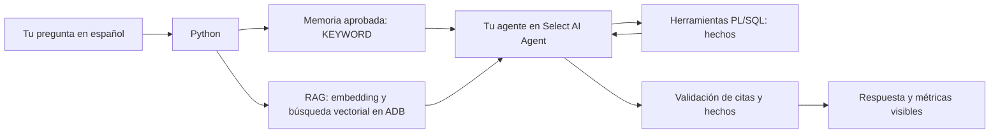

# Guía del participante — Workshop 3

Construirás un agente que investiga pagos **sintéticos** usando Oracle AI Agent Memory, evidencia contractual versionada, Select AI Agent y herramientas PL/SQL. Completarás una herramienta, definirás el objetivo y las instrucciones de tu agente, registrarás seis objetos nativos en ADB y le harás preguntas en lenguaje natural. Verás las fuentes del RAG, los hechos consultados y métricas reales; aprobarás un caso y una memoria por separado.

La sesión dura **180 minutos**. La instalación y los accesos se completan **antes**. Esta guía contiene el recorrido completo para Windows y una sección de comandos para macOS/Linux al final. No necesitas crear recursos OCI, políticas IAM, usuarios, almacenes de memoria ni perfiles de modelos.


## Continuar desde el dashboard conectado

Si ya ves **Identidad individual de base de datos verificada** y el facilitador confirmó que las herramientas PL/SQL están preparadas, continúa en [11.2: Define y registra el agente nativo](#112-define-y-registra-el-agente-nativo). Allí están los textos para completar los campos y los botones que debes pulsar. La actividad SQL de 11.1 se realiza si forma parte del recorrido acordado para tu sesión.

La instalación y la conexión de los pasos 1–8 no se repiten durante este recorrido. Construye y verifica el agente antes de enviar la consulta del paso 12.

## 0. Qué estás construyendo y por qué

El caso contiene dos solicitudes sintéticas con la misma clave de idempotencia y distinto contenido. Tu agente deberá investigar esa diferencia y justificar una recomendación. No ejecutará pagos ni reembolsos.

| Pieza | Su función en la investigación |
|---|---|
| Contrato v2 | Define cómo tratar reintentos con contenido igual o diferente. |
| Memoria procedural | Recupera un procedimiento aprobado; no reemplaza al contrato. |
| Herramienta PL/SQL | Consulta hechos actuales, como claves y hashes de solicitudes. |
| Agente | Selecciona herramientas y propone una respuesta con fuentes. |
| Revisión humana | Decide por separado si se guarda el caso y si se aprueba una nueva lección. |

Primero comprobarás las piezas por separado. Probar SQL desde la terminal todavía no ejecuta al agente. Después realizarás una investigación desde el dashboard y revisarás qué herramientas y fuentes usó. Una respuesta sin evidencia puede detener el recorrido: conserva el informe y no repitas llamadas pagadas sin revisar la causa.

## 1. Antes de comenzar: recibe tu asignación privada

Debes recibir por el canal privado aprobado:

| Elemento | Para qué lo necesitas |
|---|---|
| Identificador de participante asignado | Vincula tu configuración con tu esquema; no lo elijas ni copies el de otra persona. |
| Identidad OCI individual e instrucciones de acceso | Permite autenticarte para los embeddings. |
| Nombre del tenant, región y nombre del perfil CLI | Se usan al iniciar sesión en OCI. |
| ZIP privado con `participant.session.env` y una carpeta `wallet` | Contiene tu asignación y los archivos mTLS. |
| Contraseña de tu usuario de base de datos | Se solicita localmente al conectar. |
| Contraseña del wallet | Se solicita por separado; puede ser distinta de la anterior. |
| Confirmación de que tu red y tu asignación están listas | La ADB debe permitir tu conexión y tener tus objetos preparados. |
| Autorización para las investigaciones de la sesión | Cada investigación puede consumir embeddings e inferencia de chat. |

La contraseña OCI sirve para iniciar sesión en Oracle Cloud. **Contraseña de la base de datos** corresponde a tu usuario de base de datos y **Contraseña del wallet** protege los archivos mTLS; son credenciales distintas. El wallet no es una aplicación: viene en tu ZIP privado. Si el canal de entrega muestra una contraseña codificada en Base64, solicita o selecciona su valor **decodificado**; no pegues el texto codificado en el dashboard. Los participantes no necesitan acceso administrativo a Vault.

**Si falta algo, detente y avisa al facilitador.** Descargar GitHub no crea una cuenta ni entrega un wallet. No uses credenciales administrativas, otra asignación o configuraciones de workshops anteriores. El corpus ampliado, su calibración, el owner de memoria, las funciones PL/SQL y WS3_PROFILE deben estar preparados previamente. Tú crearás el agente, su tarea, sus tres herramientas registradas y su equipo desde el dashboard. Esta edición requiere un piloto real antes de distribuir nuevas asignaciones; una asignación anterior con dos cláusulas no habilita sus consultas.

Trabaja únicamente con datos sintéticos. Nunca pegues contraseñas, wallets, archivos de sesión, perfiles OCI ni datos de clientes en una pregunta, un issue o GitHub. El dashboard es un prototipo de aprendizaje, no una aplicación de pagos de producción.

## 2. Instala y verifica Python 3.11.9

1. Abre [la página oficial de Python 3.11.9](https://www.python.org/downloads/release/python-3119/).
2. En **Files**, elige **Windows installer (64-bit)** si tu equipo Windows usa Intel/AMD de 64 bits. Para otra arquitectura, usa el instalador indicado por tu área de TI. No descargues el paquete embebible.
3. Abre el instalador, marca **Add python.exe to PATH** e instala para tu usuario. Si tu organización exige autorización de software, solicítala antes del workshop.
4. Cierra las terminales que ya estaban abiertas.
5. Abre Inicio, escribe **PowerShell** y abre una ventana normal; el laboratorio no requiere ejecutarla como administrador.
6. Ejecuta:

```powershell
py -3.11 --version
```

Debes ver `Python 3.11.9`. Es la versión base del workshop, no una indicación de que sea la versión más reciente de Python. Si aparece otra, resuélvelo durante el prework antes de instalar dependencias. No desinstales versiones que usan otros proyectos.

## 3. Descarga el repositorio

Elige **una** alternativa.

### Alternativa A: con Git

Si `git --version` funciona, ejecuta:

```powershell
New-Item -ItemType Directory -Force "$HOME\Documents\KhipuLabs" | Out-Null
Set-Location "$HOME\Documents\KhipuLabs"
git clone https://github.com/KarinaGalindezOra/kipu-workshop-oci-ai.git
Set-Location .\kipu-workshop-oci-ai
```

Si ya tienes ese repositorio, entra en su carpeta y ejecuta `git status --short`. Si no muestra cambios locales, actualiza con `git pull --ff-only`. Si tienes trabajo propio, pide ayuda antes de actualizar; no lo descartes ni clones encima.

### Alternativa B: ZIP de GitHub, sin Git

1. Abre [el repositorio público](https://github.com/KarinaGalindezOra/kipu-workshop-oci-ai).
2. Selecciona el botón verde **Code** y después **Download ZIP**.
3. Busca el ZIP en **Descargas** con el Explorador de archivos.
4. Haz clic derecho y selecciona **Extraer todo**. Extráelo bajo `Documentos\KhipuLabs`. No ejecutes archivos dentro de la vista previa del ZIP.
5. Abre la carpeta extraída que contiene `README.md`, `pyproject.toml` y `labs`. Puede llamarse `kipu-workshop-oci-ai-main`.
6. Haz clic en la barra de direcciones de esa carpeta, escribe `powershell` y presiona Enter.

En cualquiera de las alternativas, verifica tu ubicación:

```powershell
Get-Location
Test-Path .\pyproject.toml
Test-Path .\labs\lab03_payment_agent\ui\app.py
```

Ambas comprobaciones deben devolver `True`. En esta guía, **raíz del repositorio** significa esta carpeta; no significa `labs`, `Descargas` ni la carpeta que contiene al repositorio.

## 4. Crea el entorno virtual e instala dependencias

Desde la raíz del repositorio, ejecuta una línea a la vez:

```powershell
py -3.11 -m venv .venv
.\.venv\Scripts\Activate.ps1
python --version
python -c "import sys; print(sys.executable)"
```

Debes ver Python `3.11.9` y una ruta que termina en `.venv\Scripts\python.exe` dentro de este repositorio.

Si PowerShell bloquea `Activate.ps1`, **no cambies la política de seguridad del equipo**. Puedes usar el ejecutable directamente: en los comandos siguientes sustituye `python` por `.\.venv\Scripts\python.exe`, y `oci` por `.\.venv\Scripts\oci.exe`. No es obligatorio activar el entorno si usas esas rutas.

Instala y comprueba:

```powershell
python -m pip install --upgrade pip
python -m pip install -e ".[dev,lab03-agent]"
python -m pip check
python -m lab03_payment_agent.participant --help
python -m pytest labs/lab03_payment_agent/tests -q
```

Espera a que termine cada comando. Debes obtener: instalación exitosa, ninguna dependencia incompatible, ayuda con las operaciones del participante y pruebas locales aprobadas. La prueba de integración OCI debe aparecer omitida. Estas pruebas no consumen modelos ni acreditan una ejecución en OCI.

Si aparece `ModuleNotFoundError`, vuelve a comprobar la carpeta y el ejecutable de Python; repite la instalación editable con `-e`. No instales globalmente para ocultar el problema.

## 5. Extrae tu paquete privado fuera del repositorio

1. Guarda el ZIP privado recibido en **Descargas**, con el nombre local `workshop3-private.zip`. Es distinto del ZIP público de GitHub.
2. Define estas rutas en PowerShell:

```powershell
$WorkshopPrivate = Join-Path $HOME "KhipuPrivate\workshop3\assignment"
$WorkshopSession = Join-Path $WorkshopPrivate "participant.session.env"
$WorkshopEvidence = Join-Path $HOME "KhipuPrivate\workshop3\evidence"
$WorkshopArchive = Join-Path $HOME "Downloads\workshop3-private.zip"
Test-Path -LiteralPath $WorkshopArchive
Test-Path -LiteralPath $WorkshopPrivate
```

La primera comprobación debe ser `True`. Si la segunda ya es `True`, consulta si esa asignación sigue vigente; no extraigas otro paquete encima.

3. Para una carpeta de asignación nueva, ejecuta:

```powershell
Expand-Archive -LiteralPath $WorkshopArchive -DestinationPath $WorkshopPrivate
New-Item -ItemType Directory -Force $WorkshopEvidence | Out-Null
Test-Path -LiteralPath $WorkshopSession
Test-Path -LiteralPath (Join-Path $WorkshopPrivate "wallet\ewallet.pem")
Test-Path -LiteralPath (Join-Path $WorkshopPrivate "wallet\tnsnames.ora")
```

Las tres últimas comprobaciones deben devolver `True`. Si el ZIP tenía una carpeta adicional, revisa la estructura en el Explorador: `participant.session.env` y `wallet` deben estar directamente dentro de la carpeta de asignación que definiste. No copies el paquete al repositorio para resolver una ruta.

4. Abre el archivo de sesión localmente:

```powershell
notepad $WorkshopSession
```

5. Comprueba que el identificador del participante es el asignado. Ajusta **únicamente** `LAB03_WALLET_DIR` para que apunte a tu carpeta absoluta del wallet. Usa `/` en esta cadena para evitar escapes de Windows, por ejemplo:

```dotenv
LAB03_WALLET_DIR="C:/Users/YourWindowsName/KhipuPrivate/workshop3/assignment/wallet"
```

Sustituye `YourWindowsName` por tu carpeta real de Windows; guarda y cierra el editor. Conserva el descriptor de conexión, los identificadores esperados, los modelos, la versión y la calibración. **No agregues contraseñas.** El archivo público `config/participant.env.example` documenta los campos; no reemplaza tu asignación preparada.

## 6. Inicia sesión en OCI con tu identidad individual

1. Obtén de tu asignación privada el **nombre del tenant**, la **región** y el **nombre del perfil CLI**. Completa estas variables; los textos entre `< >` son marcadores que debes reemplazar:

```powershell
$WorkshopTenancy = "<tenancy_name_from_your_assignment>"
$WorkshopRegion = "<region_from_your_assignment>"
$WorkshopProfile = "<profile_name_from_your_assignment>"
```

No ejecutes la autenticación mientras quede un marcador. El nombre de perfil es una etiqueta local; no es un OCID ni una contraseña.

2. Ejecuta:

```powershell
oci --version
oci session authenticate --tenancy-name $WorkshopTenancy --region $WorkshopRegion --profile-name $WorkshopProfile --session-expiration-in-minutes 60
```

3. En el navegador, completa el inicio de sesión con **tu identidad OCI asignada**. Si el navegador ya está autenticado como otra persona, detente y corrígelo con el facilitador.
4. Regresa a la terminal, completa cualquier pregunta pendiente y espera a que finalice el comando.
5. Valida la sesión:

```powershell
oci session validate --profile $WorkshopProfile --auth security_token
oci iam region list --profile $WorkshopProfile --auth security_token --output table
```

Debes ver la vigencia de la sesión y una tabla de regiones. No abras ni muestres el contenido de tokens o claves. El procedimiento se basa en [la documentación oficial de autenticación temporal de OCI CLI](https://docs.oracle.com/en-us/iaas/Content/API/SDKDocs/clitoken.htm).

**La sesión CLI dura menos que el workshop.** Antes de que expire, renueva tu propia sesión:

```powershell
oci session refresh --profile $WorkshopProfile --auth security_token
oci session validate --profile $WorkshopProfile --auth security_token
```

Si la renovación falla o la sesión ya expiró, repite el inicio de sesión con navegador y el mismo perfil asignado. Conectar nuevamente el dashboard no renueva OCI. Comprueba la vigencia antes de la investigación y antes de la evaluación de casos negativos.

## 7. Comprueba la asignación y ADB

Desde la raíz del repositorio y con las variables anteriores definidas:

```powershell
python -m lab03_payment_agent.participant readiness --session-file "$WorkshopSession"
```

La terminal solicita dos contraseñas:

1. `Contraseña de la base de datos:`: la de tu usuario individual de aplicación.
2. `Contraseña del wallet:`: la del wallet.

Los caracteres pueden no verse mientras escribes. Ingresa o pega la contraseña una vez y presiona Enter. Debes obtener:

```text
ASSIGNMENT_AND_DATABASE_READY; NO_INFERENCE_CALLS
```

La comprobación valida que el perfil local corresponde a la asignación, que la conexión autenticada usa el esquema esperado y que las tablas y funciones base están listas. No exige que tu nuevo equipo exista: lo construirás en el paso 11. No ejecuta embeddings ni el agente.

Si falla, consulta la tabla de problemas al final. No crees usuarios, cambies permisos o edites los identificadores esperados para eludir la comprobación.

## 8. Abre el dashboard local

En esa terminal ejecuta:

```powershell
python -m streamlit run labs/lab03_payment_agent/ui/app.py --server.address 127.0.0.1 --server.port 8503 --server.fileWatcherType none
```

Deja la terminal abierta. Si no se abre el navegador, visita [http://127.0.0.1:8503](http://127.0.0.1:8503). El dashboard debe estar ligado a `127.0.0.1`, no a una dirección pública.

En la barra lateral izquierda:

1. Expándela si está contraída.
2. En **Archivo privado de sesión**, pega la ruta absoluta de `$WorkshopSession`, no su contenido. Si necesitas ver solo la ruta, usa `Write-Output $WorkshopSession` en una terminal donde esté definida la variable.
3. En **Carpeta privada de evidencias**, introduce tu carpeta privada de evidencia.
4. Completa **Contraseña de la base de datos** y **Contraseña del wallet**.
5. Selecciona **Conectar y verificar preparación** una vez y espera **Identidad individual de base de datos verificada**.

Si el puerto está ocupado, detén ese comando con Ctrl+C, repítelo con `--server.port 8504` y abre `http://127.0.0.1:8504`. No inicies varios dashboards con la misma asignación.

**El prework termina cuando los pasos 2–8 funcionan.** La agenda de tres horas comienza a continuación.

## 9. Minutos 0–15: entiende el resultado que buscas

Al terminar deberás poder explicar y demostrar cinco cosas:

1. **Construí un agente:** definí objetivo e instrucciones y comprobé seis objetos nativos en ADB.
2. **Le pregunté en lenguaje natural:** envié mi pregunta en español y observé sus herramientas reales.
3. **Inspeccioné el RAG:** identifiqué cláusula, versión, filtros, distancia y cita usadas en la respuesta.
4. **Separé memoria de hechos:** una regla aprendida orienta el trabajo; el contrato establece la regla vigente; SQL demuestra los hechos actuales.
5. **Evalué y aprendí:** registré latencia y evidencias, aprobé un caso y una lección, y recuperé la lección tras reconectar.

Abre las cinco pestañas del dashboard: **Construir mi agente**, **Consultar**, **Evidencia RAG**, **Memoria** y **Evaluar**. La barra lateral solo configura la conexión. Puedes explorar definiciones, documentos y un informe guardado sin conexión; eso no crea un agente ni ejecuta OCI.



Python recupera memoria y contrato antes de invocar al agente. El agente decide sus llamadas operativas dentro de una tarea preparada. No es un chat general: el ejercicio está acotado a investigar idempotencia de pagos sintéticos. Las afirmaciones contractuales deben citar frases verificables; no ofrece asesoría sobre temas ausentes del corpus.

Guarda una copia privada del [cuaderno](participant_workbook.md). Anota resultados reales y deja como pendiente lo que no hayas ejecutado.

## 10. Minutos 15–40: descubre el contrato y la memoria

1. Abre **Evidencia RAG**. Selecciona la biblioteca ampliada de 12 cláusulas.
2. Expande una cláusula v2 sobre payload diferente y otra sobre payload igual. Lee también el documento [payments-v2.md](../data/contracts/payments-v2.md).
3. Comprueba identificador, sección y líneas. En v1, identifica la ambigüedad sobre reintentos.
4. Usa **Explorar cláusulas por texto** para localizar una frase. Esta búsqueda es local y por texto; no es RAG vectorial.
5. Con la asignación conectada, pulsa **Comprobar fragmentos indexados en mi corpus (sin inferencia)**. Deben existir 3 fragmentos v1 y 9 v2 en el corpus asignado. Si solo hay dos cláusulas antiguas, detente: la nueva preparación sigue pendiente.
6. Abre **Memoria** y pulsa **Recuperar memorias aprobadas (sin inferencia)**. Lee `seed-idempotency`, versión v2, procedencia `seed`.
7. Explica por qué esa memoria no demuestra que PAY-104 tenga un conflicto: para eso hay que consultar solicitudes actuales.

La recuperación vectorial real ocurrirá al enviar una consulta. Entonces verás pregunta → embedding → filtros de corpus/API/versión → candidatos y distancia coseno → cláusulas aceptadas → citas. Una distancia menor indica mayor cercanía en este modelo; no equivale a un porcentaje de confianza. No cambies el umbral calibrado.

## 11. Minutos 40–80: completa una herramienta y construye tu agente

### 11.1 Completa la consulta de solicitudes

Abre una segunda terminal PowerShell en la raíz del repositorio. Define nuevamente las variables, porque no se comparten entre ventanas:

```powershell
.\.venv\Scripts\Activate.ps1
$WorkshopPrivate = Join-Path $HOME "KhipuPrivate\workshop3\assignment"
$WorkshopSession = Join-Path $WorkshopPrivate "participant.session.env"
$WorkshopEvidence = Join-Path $HOME "KhipuPrivate\workshop3\evidence"
python -m lab03_payment_agent.participant backup-tool --session-file "$WorkshopSession" --output "$WorkshopPrivate\find_related_requests.before.sql"
notepad .\labs\lab03_payment_agent\exercises\find_related_requests.sql
```

El respaldo solicita las dos contraseñas; no sobrescribe uno existente. Si ya lo tienes, consérvalo y omite ese comando.

Completa el archivo abierto:

1. Conserva nombre, parámetro `p_payment_id`, retorno CLOB y `AUTHID CURRENT_USER`.
2. Sustituye el error de ejemplo por un `SELECT` estático sobre `WS3_REQUESTS` con `WHERE payment_id = p_payment_id`.
3. Usa `JSON_OBJECT` para un elemento con `request_id`, `idempotency_key` y `payload_hash`.
4. Agrupa elementos con `JSON_ARRAYAGG`, ordenados por `request_id`. Incluye `RETURNING CLOB` donde corresponda.
5. Usa `COALESCE` con `TO_CLOB('[]')` cuando no hay filas. El objeto exterior debe tener `requests` como arreglo JSON: usa `FORMAT JSON`, para que no sea una cadena escapada.
6. Selecciona el objeto exterior en `l_payload`. Conserva `RETURN WS3_TRACE('find_related_requests',p_payment_id,l_payload);`, que registra el resultado verificable.
7. Elimina TODOs y el `RAISE_APPLICATION_ERROR` de ejemplo, guarda UTF-8 y cierra.

No fijes PAY-104 ni valores de ejemplo dentro de la función. No agregues DML, SQL dinámico, HTTP ni grants.

Instala y prueba, una línea a la vez:

```powershell
python -m lab03_payment_agent.participant install-tool --session-file "$WorkshopSession" --sql-file labs/lab03_payment_agent/exercises/find_related_requests.sql
python -m lab03_payment_agent.participant test-tool --session-file "$WorkshopSession" --payment-id PAY-104 --output "$WorkshopEvidence\tool-PAY-104.json"
python -m lab03_payment_agent.participant test-tool --session-file "$WorkshopSession" --payment-id PAY-999 --output "$WorkshopEvidence\tool-PAY-999.json"
```

Cada comando solicita las dos contraseñas. PAY-104 debe mostrar dos solicitudes, misma clave y hashes diferentes. PAY-999 debe devolver `requests: []`. Verifica `agent_executed: false` e `inference_calls: 0`: probaste la herramienta directamente, todavía no al agente. Conserva los archivos; si existen, elige nombres nuevos.

### 11.2 Define y registra el agente nativo

Vuelve al navegador y abre **Construir mi agente**:

1. En el campo **Objetivo de mi agente**, sustituye el texto inicial por:

   > Investigar reintentos de pagos sintéticos y recomendar una acción respaldada por el contrato vigente y los hechos consultados.

2. En **Instrucciones que debe respetar**, sustituye el texto inicial por:

   > Consulta el pago, sus eventos y las solicitudes relacionadas. Compara claves de idempotencia y hashes del payload. Cita el contrato seleccionado. Si falta evidencia, indícalo. La memoria no sustituye al contrato. No ejecutes pagos ni reembolsos. El registro de casos y la aprobación de memorias requieren revisión humana.

3. En **Herramientas disponibles**, conserva seleccionadas `get_payment`, `get_payment_events` y `find_related_requests`. Esta tarea necesita las tres; no admite SQL arbitrario.
4. Pulsa **Generar definición revisable**. Debe aparecer una tabla con **seis objetos**: tres herramientas, un agente, una tarea y un equipo. En este punto solo generaste el diseño local: todavía no creaste esos objetos en ADB ni ejecutaste el modelo.
5. Abre **Inspeccionar instrucciones y SQL que construyen el agente**. Identifica seis llamadas `CREATE_*` de `DBMS_CLOUD_AI_AGENT`: tres herramientas, un agente, una tarea y un equipo.
6. Distingue la función PL/SQL que acabas de completar de la herramienta registrada que permite al agente llamarla. Revisa también las restricciones fijas de la tarea.
7. Descarga la definición SQL si quieres conservarla. No la ejecutes también por terminal: usa un único mecanismo de registro.
8. Si la asignación y autorización de tu sesión están confirmadas, marca **He revisado y autorizo crear estos seis objetos en mi esquema.** y pulsa **Registrar mi agente en ADB** una vez.
9. Comprueba el recibo con seis nombres, `embedding_calls: 0` y `agent_runs: 0`. Pulsa **Inspeccionar equipos registrados (sin inferencia)** y localiza `WS3_LEARN_TEAM`.

Ahora sí construiste un agente nativo ejecutable. Todavía no lo has invocado. Se reutiliza `WS3_PROFILE`, preparado por el facilitador; no se crean perfiles, permisos IAM ni usuarios. Si alguno de los seis objetos ya existe, no se reemplaza: conserva la definición y solicita revisión. No borres objetos para repetir el ejercicio.

## 12. Minutos 80–110: pregunta y observa una investigación real

1. Abre **Consultar**. Selecciona PAY-104 y contrato v2.
2. Escribe: **Investiga las solicitudes de PAY-104: compara sus claves de idempotencia y hashes del payload, y determina qué hacer con la solicitud original según el contrato v2.** Puedes reformularla sobre el mismo caso; el texto escrito se envía como pregunta, no se sustituye por una pregunta fija en inglés.
3. Verifica que la sesión OCI siga vigente. Si no, renueva según el paso 6.
4. Confirma con el facilitador que este intento está autorizado. Marca la casilla de consumo y pulsa **Enviar consulta al agente** una sola vez.
5. Observa las cuatro fases: memoria, RAG, agente/herramientas y validación. La ejecución puede tardar varios minutos. No recargues ni abras otro proceso para repetirla.
6. Lee la respuesta en **Consultar** y abre las tres observaciones de herramientas. Compara solicitudes, claves y hashes. El resumen de hechos es una presentación de resultados SQL; el texto original del modelo se conserva aparte.
7. Abre **Evidencia RAG**. Compara la cláusula citada con su documento, versión y fragmento. Revisa candidatos, distancias, umbral y aceptación. Si el reporte antiguo no guardó todos los candidatos, lo indicará.
8. Abre **Memoria**. Distingue memorias recuperadas de memorias que el modelo citó explícitamente. Recuperar una memoria no prueba que causara una mejor respuesta.
9. Abre **Evaluar**. Registra duración, herramientas observadas, fuentes, memorias y embeddings. Las latencias por fase aparecen solo si fueron medidas. Tokens o llamadas internas no expuestos dicen **No disponible**.
10. Descarga la evidencia JSON y conserva también el informe Markdown exportado en tu carpeta privada, bajo tu identidad y el identificador de ejecución.

El resultado esperado de PAY-104/v2 es `answered`, hallazgo `ESCALATE`, evidencia contractual y solicitudes con hashes distintos. `insufficient_evidence`, `conflict`, `requires_clarification` y `error` son estados distintos: lee el motivo y no apruebes una propuesta inexistente.

Una ejecución puede llamar varias veces al proveedor internamente. Una observación de herramienta no equivale a una llamada al modelo. Una prueba SQL con cero inferencias tampoco acredita la ejecución del agente.

## 13. Minutos 110–135: revisa y registra el caso

1. En **Consultar**, comprueba que pregunta, pago y versión corresponden al resultado. No cambies estos campos antes de confirmar.
2. Lee la propuesta de caso completa. Contrasta sus identificadores de solicitud con las tablas observadas y el contrato.
3. Solo si estás de acuerdo, marca **He revisado y apruebo este caso exacto.** y pulsa **Registrar caso**.
4. Conserva el recibo `saved`. Repetir la misma confirmación debe devolver `already_saved`; no debe crear otro caso.

La operación de registro es independiente de las herramientas del modelo. Guardar el caso no guarda una memoria. Si cambia el contenido de la propuesta, necesitarás revisar y aprobar el nuevo contenido.

## 14. Minutos 135–155: aprueba una memoria y recupérala

1. Abre **Memoria**, sección **Aprueba una lección reutilizable**.
2. Lee identificador, contenido, versión y `source_run`. La lección debe ser compatible con el contrato y no incluir datos personales ni secretos.
3. Marca **Apruebo este procedimiento y su procedencia.** y pulsa **Guardar memoria aprobada**.
4. Conserva el recibo. La misma aprobación repetida debe devolver `already_saved`.
5. Abre la barra lateral y pulsa **Desconectar / iniciar una sesión nueva**.
6. Conecta de nuevo con el mismo archivo y las dos contraseñas. No cambies tu identidad ni tu configuración privada.
7. Abre **Memoria** y pulsa **Recuperar memorias aprobadas (sin inferencia)**. Busca `payment-idempotency-approved`, versión v2, y el identificador de tu ejecución como procedencia.

Esto demuestra persistencia entre sesiones. No demuestra todavía una mejora de calidad; esa afirmación necesitaría comparar ejecuciones controladas con y sin memoria, con presupuesto separado. La extracción automática está deshabilitada.

## 15. Minutos 155–175: evalúa límites y negativos

La pestaña **Evaluar** muestra escenarios esperados, no resultados ejecutados. Coordina cuáles tienen autorización de consumo; no ejecutes todos automáticamente.

| Pregunta/caso | Qué contrastar |
|---|---|
| PAY-105/v2: reintento con igual contenido | No recomendar otro pago ni escalar por hashes distintos inexistentes. |
| PAY-999/v2: pago ausente | Abstenerse por falta de hechos; no inventar solicitudes. |
| PAY-104/v1 | Exponer incompatibilidad con la memoria v2; no sustituir contrato. |
| Sin versión | Pedir aclaración antes de inferir. |
| SLA o garantías ausentes del corpus | Evidencia insuficiente, sin inventar cláusulas. |

Para cada consulta realmente ejecutada, anota pregunta, estado esperado/observado, fuentes y latencia en el cuaderno. Una casilla favorable de evaluación no constituye una medición de precisión estadística. El aislamiento entre dos identidades se comprueba con el facilitador y credenciales reales, sin intercambiarlas entre participantes.

Para inspeccionar un resultado anterior sin costo, abre **Evaluar → Abrir un informe privado guardado**, pega su ruta absoluta JSON y pulsa **Abrir informe local**. Verás sus métricas históricas y evidencia, etiquetadas como lectura local. Eso no repite ni revalida OCI y no habilita confirmaciones. Un informe `stored_oci_revalidation` conserva la duración original y diferencia la recuperación posterior.

## 16. Minutos 175–180: explica lo que construiste

- [ ] Puedo señalar mi objetivo, instrucciones, tres herramientas, tarea y equipo nativos.
- [ ] Hice una consulta en lenguaje natural y comprobé resultados de herramientas.
- [ ] Identifiqué la cláusula y la versión recuperadas por RAG.
- [ ] Registré métricas medidas y dejé como no disponibles las ausentes.
- [ ] Distinguí memoria recuperada de memoria citada por el modelo.
- [ ] Aprobé el caso y la lección por separado y comprobé que no se duplican.
- [ ] Recuperé la lección desde una sesión nueva.
- [ ] Dejé pendientes explícitos para negativos, aislamiento y comparaciones no ejecutados.

No borres tablas, usuarios, memorias ni recursos compartidos. Una limpieza requiere revisión de impacto y autorización separadas.

## Solución de problemas: detente en el primer paso que falla

| Problema | Acción |
|---|---|
| `py` o Python no se reconoce | Reabre PowerShell después de instalar y repite el paso 2. Si no está disponible 3.11.9, resuélvelo con el facilitador. |
| `Activate.ps1` está bloqueado | Usa los ejecutables de `.venv` directamente, como explica el paso 4. No cambies la política global. |
| `No module named lab03_payment_agent` | Vuelve a la raíz y repite la instalación editable con el Python de esa `.venv`. |
| Una comprobación de ruta dice `False` | Inspecciona la estructura en el Explorador y corrige la ruta local; no copies secretos al repositorio. |
| No se reconoce `oci` | Comprueba que terminó la instalación y usa `.\.venv\Scripts\oci.exe` si no activaste el entorno. |
| Sesión expirada o perfil inexistente | Renueva o repite la autenticación de tu propio perfil, paso 6. No cambies los identificadores esperados. |
| Error de contraseña o wallet | Revisa cuál contraseña corresponde a cada campo y que la ruta sea absoluta. Pide revisar tu red y la preparación de la asignación. |
| Hay una investigación activa | Detente. Un timeout puede requerir revisión del servidor; no retires locks ni reintentes desde otro proceso. |
| La instalación rechaza TODOs | Completa el archivo, elimina marcadores y el error de ejemplo, guarda UTF-8 e instala de nuevo. |
| Error de compilación | Corrige las líneas/posiciones informadas y reinstala. Puedes restaurar tu respaldo privado. No necesitas una llamada al modelo para reparar SQL. |
| Ya existe el archivo de prueba | Consérvalo y elige un nombre nuevo. |
| El dashboard no conecta | Ejecuta readiness en terminal y comunica la clase/código seguros del error. No compartas configuraciones ni mensajes crudos del driver. |
| La investigación devuelve error o timeout | Conserva evidencia, no apruebes un caso y solicita revisar la ejecución antes de otro intento pagado. |
| Cita inválida o evidencia insuficiente | Revisa la versión, las fuentes y **Métricas**. `rag_candidate_count`, `rag_best_distance`, `rag_distance_threshold` y `rag_accepted_count` permiten distinguir falta de candidatos de rechazo por distancia. Solicita revisar la calibración; no aumentes el umbral ni repitas una investigación pagada por tu cuenta. |
| Escritura de caso/memoria incierta | Conserva la propuesta exacta y solicita auditar su clave antes de reintentar. |
| No aparece la memoria al reconectar | Comprueba que aprobaste y guardaste la lección por separado. Revisa identificador, versión y procedencia; solicita una auditoría acotada. |

Si el facilitador confirma que una tarea nativa terminó correctamente pero falló la presentación de su respuesta, abre **Recuperar una respuesta completada sin otra ejecución pagada**, introduce el identificador indicado en **Identificador de la ejecución completada** y pulsa **Recuperar respuesta completada (sin inferencia)**. Esta operación exige el informe original, la tarea exitosa para la misma solicitud, las trazas reales y las fuentes verificables. Conserva el informe con error y genera evidencia separada con modo `stored_oci_revalidation`; no es una nueva investigación ni una simulación. No uses **Enviar consulta al agente** como alternativa a esta recuperación.

Para solicitar ayuda, indica el paso de la guía, la clase/código seguros y el identificador sintético de ejecución si existe. Nunca adjuntes contraseñas, wallets, perfiles OCI, tokens o archivos privados de sesión.

## Referencia de comandos para macOS/Linux

Usa el mismo repositorio, paquete privado y actividades. Primero `python3.11 --version` debe mostrar **3.11.9**. La página oficial de Python indicada antes incluye el instalador macOS. En Linux, prepara la versión exacta con TI/facilitador durante el prework; no reemplaces el Python del sistema durante la sesión.

Desde la raíz del repositorio:

```bash
python3.11 -m venv .venv
source .venv/bin/activate
python --version
python -m pip install --upgrade pip
python -m pip install -e '.[dev,lab03-agent]'
python -m pip check
python -m pytest labs/lab03_payment_agent/tests -q
```

Extrae el ZIP **privado** con la herramienta de archivos de tu sistema en `$HOME/KhipuPrivate/workshop3/assignment`, fuera del repositorio. Verifica `participant.session.env` y `wallet/ewallet.pem`. Edita la ruta absoluta del wallet con tu editor; conserva el resto de los valores asignados.

```bash
export WORKSHOP_PRIVATE="$HOME/KhipuPrivate/workshop3/assignment"
export WORKSHOP_SESSION="$WORKSHOP_PRIVATE/participant.session.env"
export WORKSHOP_EVIDENCE="$HOME/KhipuPrivate/workshop3/evidence"
mkdir -p "$WORKSHOP_EVIDENCE"
export WORKSHOP_TENANCY="<tenancy_name_from_your_assignment>"
export WORKSHOP_REGION="<region_from_your_assignment>"
export WORKSHOP_PROFILE="<profile_name_from_your_assignment>"
oci session authenticate --tenancy-name "$WORKSHOP_TENANCY" --region "$WORKSHOP_REGION" --profile-name "$WORKSHOP_PROFILE" --session-expiration-in-minutes 60
oci session validate --profile "$WORKSHOP_PROFILE" --auth security_token
python -m lab03_payment_agent.participant readiness --session-file "$WORKSHOP_SESSION"
python -m streamlit run labs/lab03_payment_agent/ui/app.py --server.address 127.0.0.1 --server.port 8503 --server.fileWatcherType none
```

Reemplaza los marcadores antes de autenticarte y completa el inicio de sesión del paso 6. En la segunda terminal de ejercicios, activa `.venv` y define de nuevo las variables. Los subcomandos son los mismos; cambia rutas a `/` y variables a sintaxis Bash:

```bash
python -m lab03_payment_agent.participant backup-tool --session-file "$WORKSHOP_SESSION" --output "$WORKSHOP_PRIVATE/find_related_requests.before.sql"
python -m lab03_payment_agent.participant install-tool --session-file "$WORKSHOP_SESSION" --sql-file labs/lab03_payment_agent/exercises/find_related_requests.sql
python -m lab03_payment_agent.participant test-tool --session-file "$WORKSHOP_SESSION" --payment-id PAY-104 --output "$WORKSHOP_EVIDENCE/tool-PAY-104.json"
python -m lab03_payment_agent.participant test-tool --session-file "$WORKSHOP_SESSION" --payment-id PAY-999 --output "$WORKSHOP_EVIDENCE/tool-PAY-999.json"
```

El agente se construye desde la pestaña del paso 11.2. Realiza las ediciones y respaldos de la herramienta explicados en el paso 11.1 antes de instalar; no ejecutes los archivos incompletos. Renueva con `oci session refresh --profile "$WORKSHOP_PROFILE" --auth security_token` antes de que expire. El recorrido de revisión, evidencia y cierre del dashboard es el mismo.
